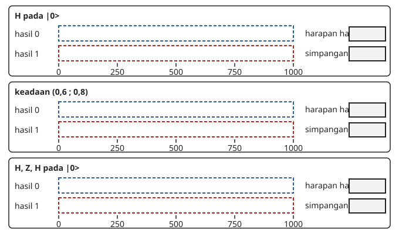

**Ingat dulu:** Tanpa melihat catatan, jawab. (1) Matriks `R = [[0, -1], [1, 0]]` diterapkan pada `(3, 4)`: berapa hasilnya dan berapa panjangnya? ______ (2) Mengapa Z tidak mengubah peluang hasil pada `(0,7071 ; 0,7071)`, tetapi tetap mengubah keadaannya? ______ (3) Dalam simulator, bagaimana vektor keadaan disimpan dan bagaimana satu gerbang diterapkan? ______



`[Gambar: tiga panel berlabel H pada |0>, keadaan (0,6 ; 0,8), dan H Z H pada |0>. Tiap panel punya dua lajur batang mendatar berlabel hasil 0 dan hasil 1 dengan skala 0 sampai 1000 shot (tanda di 0, 250, 500, 750, dan 1000), dan kotak kosong untuk harapan hasil 0 dan simpangan wajar. Kamu mengarsir batang sesuai harapanmu.]`

**Prediksi:** Simulatormu menyimpan keadaan setelah H pada `|0>`, lalu membaca 1000 shot. Tebak dulu, tulis: (1) jumlah hasil 0 yang diharapkan dan kisaran wajarnya ______ (2) apakah hasilnya sama persis bila program dijalankan dua kali tanpa mengubah apa pun ______ (3) bila sirkuitnya H, Z, H, berapa hasil 0 dan hasil 1 ______ Lalu isi panel pada gambar.

**Lengkapi:**

1. Keadaan `(0,8 ; 0,6)` memberi P(0) = ____ dan P(1) = ____. Pada 1000 shot, harapan hasil 0 adalah ____ dan simpangan wajar kira-kira ____.
2. Lengkapi fungsi `ukur` untuk sebanyak apa pun hasil:

```cpp setengah-jadi
int ukur(const Vektor& keadaan) {
    double r = acak01();
    double kumulatif = 0;
    for (size_t i = 0; i < keadaan.size(); i++) {
        kumulatif += keadaan[i] * ____;
        if (r < ____) return ____;
    }
    return static_cast<int>(keadaan.size()) - 1;
}
```

3. Pada 1000 shot hasil 0 muncul 380 kali padahal harapannya 360 dan simpangan 15,2. Selisihnya ____ simpangan; apakah wajar? ____

**Susun:** Urutkan baris A sampai E menjadi pembangkit bilangan acak semu. `AI: tanpa AI`

```text
(A) uint32_t benih = 12345;
(B) double acak01() {
(C) benih = 1664525u * benih + 1013904223u;
(D) return benih / 4294967296.0;
(E) }
```

Urutanku: ____ , ____ , ____ , ____ , ____

**Latihan:**

1. Keadaan setelah H pada `(0,6 ; 0,8)`: tentukan peluang kedua hasil, harapan hasil 0 pada 1000 shot, dan simpangan wajar. `AI: tanpa AI` ______
2. Ubah benih menjadi 777 dan jalankan. Catat hasil 0 untuk H pada `|0>`. Mengapa hasilnya berubah padahal peluangnya sama? `AI: boleh` ______
3. Keadaan `(0,28 ; 0,96)` diberi H. Hitung vektor hasil, peluang, dan hitungan yang diharapkan pada 1000 shot. ______
4. Jika seribu shot dari peluang 0,5 memberi 515 hasil 0, apakah itu wajar? Beri kisarannya. ______

**Cek diri:**

- [ ] Saya dapat menjalankan banyak shot dan menyusun histogram.
- [ ] Saya dapat membandingkan histogram dengan peluang tangan memakai simpangan wajar.
- [ ] Saya dapat menjelaskan benih tetap dan keterbatasannya.

**Catatan cetak (untuk guru, tidak dicetak):** satu halaman A4, dicetak satu sisi. Kunci ada di modul `e-xi1-m11` bagian "Kunci dan petunjuk". Lembar tidak memuat kolom identitas (nama, kelas, tanggal, atau nilai).
