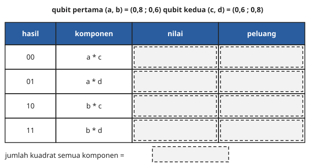

**Ingat dulu:** Tanpa melihat catatan, jawab. (1) Mengapa modulus kuadrat dari `i/akar2` sama dengan `1/akar2` kuadrat, dan apa artinya bagi peluang? ______ (2) Apa beda interferensi konstruktif dan destruktif? Beri satu contoh angka. ______ (3) Jika seribu shot dari peluang 0,5 memberi 515 hasil 0, apakah itu wajar? Beri kisarannya. ______



`[Gambar: tabel empat baris untuk hasil 00, 01, 10, dan 11. Kolom "komponen" berisi rumus a * c, a * d, b * c, dan b * d dengan qubit pertama (a, b) = (0,8 ; 0,6) dan qubit kedua (c, d) = (0,6 ; 0,8). Kolom "nilai" dan "peluang" kosong, dan satu kotak kosong di bawah untuk jumlah kuadrat semua komponen.]`

**Prediksi:** Qubit pertama berada pada `(0,6 ; 0,8)` dan qubit kedua pada `(0,8 ; -0,6)`; keduanya tidak saling terkait. Sebelum menghitung, tebak dan tulis: (1) berapa komponen vektor untuk keduanya sebagai satu sistem? ______ (2) peluang qubit pertama terbaca 0? ______ (3) apakah peluang `00` sama dengan 0,6 x 0,8 atau dengan kuadratnya? ______

**Lengkapi:**

1. `|10>` dalam vektor empat komponen adalah `(____ ; ____ ; ____ ; ____)`.
2. `(0,6 ; 0,8)` tensor `(1, 0)` = `(____ ; ____ ; ____ ; ____)`.
3. Lengkapi hasil kali tensor dua vektor:

```cpp setengah-jadi
Vektor tensor(const Vektor& p, const Vektor& q) {
    Vektor hasil;
    for (double x : p) {
        for (double y : q) hasil.push_back(____ * ____);
    }
    return hasil;
}
```

**Susun:** Urutkan baris A sampai C menjadi fungsi uji faktorisasi yang benar. Penjorokan sengaja dihilangkan.

```text
(A) bool bisaDifaktorkan(const Vektor& v) {
(B) return std::fabs(v[0] * v[3] - v[1] * v[2]) < 1e-9;
(C) }
```

Urutan: ______ ______ ______

**Latihan:**

1. `AI: tanpa AI` Isi tabel pada gambar, periksa jumlah kuadratnya pada kotak di bawah tabel, dan sebutkan peluang `01`. ______
2. `AI: tanpa AI` Keadaan `(0,5 ; 0,5 ; 0,5 ; -0,5)` sah. Apakah ia produk dua qubit? Tunjukkan dengan uji `ad = bc`. ______
3. `AI: boleh` Tulis pseudocode yang menerima dua vektor dua komponen dan mengembalikan vektor empat komponen. ______
4. Untuk keadaan `(0,48 ; -0,36 ; 0,64 ; -0,48)`, hitung peluang `10` dan peluang qubit kedua terbaca 1. ______

**Cek diri:**

- [ ] Saya dapat menuliskan empat keadaan dasar dua qubit sebagai vektor.
- [ ] Saya dapat menghitung hasil kali tensor dua keadaan satu qubit.
- [ ] Saya dapat memeriksa apakah vektor empat komponen dapat difaktorkan.

**Catatan cetak (untuk guru, tidak dicetak):** dua halaman A4. Kunci ada di modul `e-xi1-m12`, bagian "Kunci dan petunjuk". Lembar tidak memuat kolom identitas.
