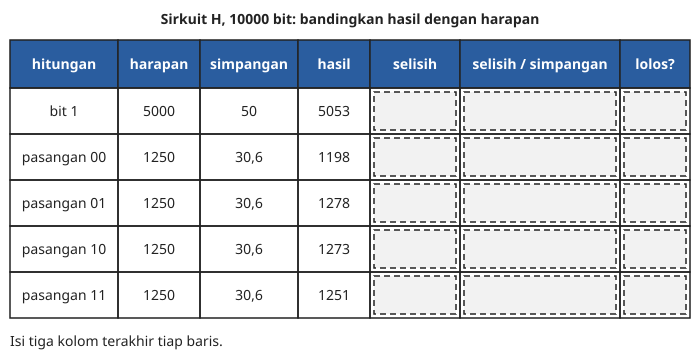

**Ingat dulu:** Tanpa melihat catatan, jawab. (1) Mengapa `(0,6 ; -0,8)` sah walaupun ada tanda minus? ______ (2) Bagaimana memeriksa bahwa keadaan hasil simulasi masih sah, dan mengapa tidak memakai `==`? ______ (3) Tulis `|01>` dan `|10>` sebagai vektor empat komponen, dengan urutan dasar yang dipakai. ______

`[Gambar: tabel uji frekuensi untuk sirkuit H dengan 10000 bit. Lima baris: bit 1, pasangan 00, pasangan 01, pasangan 10, dan pasangan 11. Kolom harapan, simpangan, dan hasil sudah terisi. Kolom selisih, selisih / simpangan, dan lolos kosong dan kamu isi untuk tiap baris.]`

**Latihan:**

1. Isi tiga kolom terakhir pada tabel di gambar, dan tulis kesimpulanmu: apakah sirkuit H lolos uji frekuensi? ______
2. Tulis rencana satu halaman untuk sirkuit pilihanmu sebelum menjalankan apa pun.

   | Bagian | Isi |
   | --- | --- |
   | Tujuan | |
   | Sirkuit | |
   | Prediksi | |
   | Kriteria selesai | |
   | Batas klaim | |

3. Keadaan `(0,6 ; 0,8)` diberi H. Hitung peluang kedua hasil dan harapan hasil 0 dari 10000 bit. ______
4. Hitung H, X, H pada `|0>` dan tulis bit yang akan dihasilkannya bila dibaca berulang. ______
5. Dari 1000 shot sebuah pembangkit memberi 540 bit 1. Hitung selisih dari harapan 500 dalam simpangan wajar, dan putuskan lolos atau tidak. ______

**Cek diri:**

- [ ] Saya menulis rencana dan prediksi sebelum menjalankan.
- [ ] Saya menguji frekuensi dalam satuan simpangan wajar.
- [ ] Saya menuliskan batas klaim: simulasi, bukan keacakan sejati.

**Catatan cetak (untuk guru, tidak dicetak):** dua halaman A4. Kunci ada di modul `e-xi1-m13`, bagian "Kunci dan petunjuk". Lembar tidak memuat kolom identitas.
