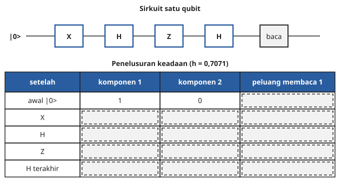

**Ingat dulu:** Tanpa melihat catatan, jawab (`AI: tanpa AI`). (1) Sebutkan satu hal yang dijanjikan komputasi kuantum dan satu hal yang bukan. ______ (2) Apakah amplitudo negatif membuat peluang negatif? Jelaskan. ______ (3) Mengapa pembangkit bilangan acak dengan benih tetap menghasilkan keluaran yang sama setiap dijalankan, dan apa artinya bagi keacakan simulasi? ______

`[Gambar: sirkuit satu qubit dari |0> melewati gerbang X, H, Z, H, lalu dibaca. Di bawahnya tabel penelusuran dengan h = 0,7071: baris "awal |0>" sudah terisi (komponen 1 sama dengan 1, komponen 2 sama dengan 0), dan baris "X", "H", "Z", "H terakhir" kosong. Kolom komponen 1, komponen 2, dan peluang membaca 1 kamu isi.]`

**Prediksi:** Sebelum menelusuri, tebak `Chance` kabel pertama untuk sirkuit pada gambar bila dibangun di Quirk. ______

**Latihan:** Kerjakan tanpa AI dan tulis langkahmu (`AI: tanpa AI`).

1. Hitung `H X` dan `X H`, dengan `H = h [[1, 1], [1, -1]]`, `h` = 0,7071, dan `X = [[0, 1], [1, 0]]`. Apakah sama? Apa artinya bagi urutan gerbang? ______
2. Tentukan `c` agar `(5c, 12c)` menjadi keadaan sah, lalu hitung peluang membaca 0 dan 1. ______
3. Hitung H pada `(0,6 ; -0,8)` dan peluang kedua hasil. ______
4. Keadaan hasil soal 3 dibaca 400 shot. Berapa hasil 1 yang diharapkan dan simpangan wajarnya? Bila sebuah simulator melaporkan 380 hasil 1, apa kesimpulanmu? ______
5. Isi tabel penelusuran pada gambar: keadaan setelah tiap gerbang dan peluang membaca 1. Di langkah mana ada interferensi dan jenis apa? ______

**Cek diri:**

- [ ] Saya dapat menghitung gerbang, aturan Born, dan hasil kali tensor dengan tangan.
- [ ] Saya dapat menelusuri sirkuit satu qubit dan menjelaskan interferensinya.
- [ ] Saya dapat membandingkan hasil shot dengan peluang memakai simpangan wajar.

**Catatan cetak (untuk guru, tidak dicetak):** dua halaman A4. Kunci ada di modul `e-xi1-m14`, bagian "Kunci dan petunjuk". Lembar tidak memuat kolom identitas.
