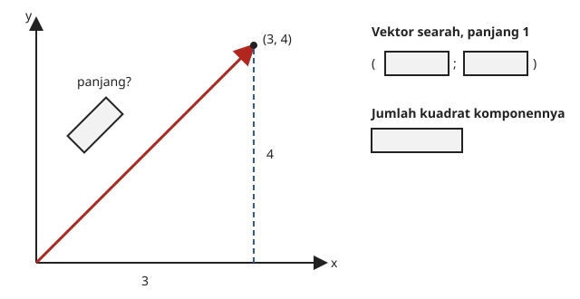

**Ingat dulu:** Tanpa melihat catatan, jawab. (1) Sebutkan satu hal yang dijanjikan komputasi kuantum dan satu hal yang bukan. ______ (2) Apa itu pasangan terurut `(a, b)`, dan apakah `(1, 2)` sama dengan `(2, 1)`? ______ (3) Berapa nilai terbesar yang muat pada 8 bit tanpa tanda minus? ______



`[Gambar: bidang koordinat dengan sumbu x dan y. Anak panah dari titik asal ke titik (3, 4) membentuk segitiga siku-siku dengan sisi mendatar 3 dan sisi tegak 4. Sisi miring (panjang vektor) diberi kotak kosong. Di sisi kanan ada kotak kosong untuk vektor satuan searah (____ , ____) dan untuk jumlah kuadrat komponennya.]`

**Prediksi:** Perhatikan vektor `(3, 4)` pada gambar. Sebelum menghitung, tebak dan tulis: (1) panjangnya ______ (2) vektor searah dengannya yang panjangnya tepat 1 ______ (3) jumlah kuadrat kedua komponen vektor yang kamu tebak di nomor 2 ______

**Lengkapi:** Lengkapi dengan vektor `(5, 12)`.

1. Panjangnya adalah akar dari `5*5 + 12*12 = ____`, yaitu ____.
2. Normalisasi: `(5/____, 12/____)`, kira-kira `(____ ; ____)` (empat desimal).
3. Jumlah kuadrat komponen hasil normalisasi: `25/169 + 144/169 = ____`.
4. Hasil kali dalam `(5, 12)` dan `(12, -5)` adalah ____, jadi keduanya ____.

**Susun:** Urutkan baris A sampai D menjadi fungsi `normalisasi`. `AI: tanpa AI`

```text
(A) double p = panjang(v);
(B)     return {v.x / p, v.y / p};
(C) Vektor normalisasi(Vektor v) {
(D) }
```

Urutanku: ____ , ____ , ____ , ____

**Latihan:**

1. Dua dadu: berapa peluang jumlah 5? Berapa peluang jumlah 11 atau lebih? Tulis pasangan yang cocok. `AI: tanpa AI` ______
2. Normalkan `(1, 2)`. Berapa panjang sebelum dan sesudahnya, dan berapa jumlah kuadrat komponen hasilnya? `AI: boleh` ______
3. Hitung hasil kali dalam `(2, 1)` dan `(1, -2)`, lalu `(1, 2)` dan `(2, 3)`. Mana yang tegak lurus? `AI: tanpa AI` ______
4. Pada `e-xi1-m1`, setelah H pertama keadaannya `(0,7071 ; 0,7071)`. Hitung panjang vektor itu. ______

**Cek diri:**

- [ ] Saya dapat menghitung panjang dan menormalkan vektor dua dimensi.
- [ ] Saya dapat menghitung hasil kali dalam dan menyebut arti hasil nol.
- [ ] Saya dapat membedakan vektor peluang dan vektor satuan.

**Catatan cetak (untuk guru, tidak dicetak):** satu halaman A4, dicetak satu sisi. Kunci ada di modul `e-xi1-m2` bagian "Kunci dan petunjuk". Lembar tidak memuat kolom identitas (nama, kelas, tanggal, atau nilai).
