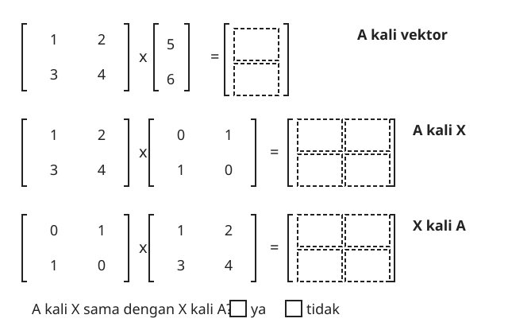

**Ingat dulu:** Tanpa melihat catatan, jawab. (1) Berapa panjang vektor `(3, 4)`, dan bagaimana menormalkannya? ______ (2) Apa arti fungsi `f` dari himpunan A ke himpunan B? Beri satu contoh. ______ (3) Ubah bilangan biner `101` ke desimal. ______



`[Gambar: tiga baris. Pertama: matriks A = [[1, 2], [3, 4]] dikali vektor (5, 6) sama dengan vektor dengan dua kotak kosong. Kedua: A kali X, dengan X = [[0, 1], [1, 0]], sama dengan matriks dua kali dua dengan empat kotak kosong. Ketiga: X kali A sama dengan matriks dua kali dua dengan empat kotak kosong. Di bawahnya ada kotak ya atau tidak untuk pertanyaan apakah A kali X sama dengan X kali A.]`

**Prediksi:** Diberikan `A`, `v = (5, 6)`, dan `X` seperti pada gambar. Sebelum menghitung, tebak dan tulis: (1) hasil `A` kali `v` ______ (2) apakah `A` kali `X` sama dengan `X` kali `A` ______ Lalu isi gambar dengan hitungan tanganmu.

**Lengkapi:**

1. `B = [[2, 0], [1, 3]]` dan `v = (1, 2)`: komponen pertama `2*1 + 0*2 = ____`, komponen kedua `1*1 + 3*2 = ____`.
2. `P = [[1, 1], [0, 1]]` dan `Q = [[1, 0], [1, 1]]`. `P` kali `Q` = `[[1*1 + 1*1, 1*0 + 1*1], [0*1 + 1*1, 0*0 + 1*1]] = [[____, ____], [____, ____]]`.
3. `Q` kali `P` = `[[____, ____], [____, ____]]`.
4. Apakah `P` kali `Q` sama dengan `Q` kali `P`? ____

**Susun:** Urutkan baris A sampai E menjadi fungsi `kaliVektor` yang memakai peubah antara `x` dan `y`. `AI: tanpa AI`

```text
(A) double y = m.c * v.x + m.d * v.y;
(B) Vektor kaliVektor(Matriks m, Vektor v) {
(C) return {x, y};
(D) double x = m.a * v.x + m.b * v.y;
(E) }
```

Urutanku: ____ , ____ , ____ , ____ , ____

**Latihan:**

1. Hitung `[[1, 0], [0, 1]]` kali `(7, -2)`. `AI: tanpa AI` ______
2. Hitung `[[2, 1], [0, 3]]` kali `(1, 1)` dan kali `(0, 1)`. Apa hubungan hasil kedua dengan kolom matriks? `AI: boleh` ______
3. Hitung `[[1, 0], [0, -1]]` kali `(0,6 ; 0,8)`. Hitung panjang sebelum dan sesudahnya. `AI: tanpa AI` ______
4. `X` kali `X` adalah identitas. Apa hasil `X` kali (`X` kali `v`) untuk sembarang `v`, dan apa artinya bagi sifat "bisa dibalik"? ______

**Cek diri:**

- [ ] Saya dapat mengalikan matriks 2 x 2 dengan vektor.
- [ ] Saya dapat mengalikan dua matriks 2 x 2.
- [ ] Saya dapat menunjukkan bahwa urutan perkalian penting.

**Catatan cetak (untuk guru, tidak dicetak):** satu halaman A4, dicetak satu sisi. Kunci ada di modul `e-xi1-m3` bagian "Kunci dan petunjuk". Lembar tidak memuat kolom identitas (nama, kelas, tanggal, atau nilai).
