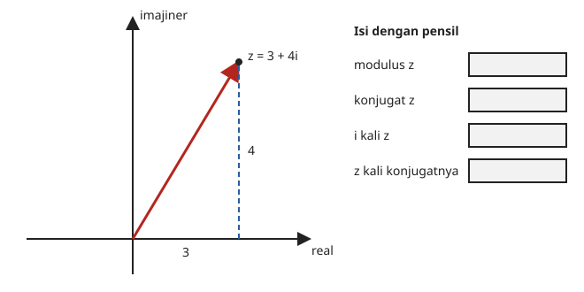

**Ingat dulu:** Tanpa melihat catatan, jawab. (1) Hitung `[[0, 1], [1, 0]]` kali `(1, 0)`. ______ (2) Mengapa kalimat "komputer kuantum mencoba semua jawaban sekaligus lalu memilih yang benar" menyesatkan? ______ (3) Hitung hasil kali dalam `(3, 4)` dan `(4, -3)`. ______



`[Gambar: bidang kompleks dengan sumbu mendatar bagian real dan sumbu tegak bagian imajiner. Titik z = 3 + 4i digambar dengan anak panah dari titik asal. Di kanan ada tiga kotak kosong: modulus z, konjugat z, dan i kali z. Di bawahnya satu kotak kosong untuk z kali konjugatnya.]`

**Prediksi:** Ambil `z = 3 + 4i`, dengan `i` bilangan yang kuadratnya -1. Sebelum menghitung, tebak dan tulis: (1) modulus `z` ______ (2) hasil `z` kali `3 - 4i` ______ (3) ke arah mana titik `(3, 4)` berpindah bila `z` dikalikan `i`, dan apakah jaraknya dari titik asal berubah? ______ Lalu isi kotak pada gambar.

**Lengkapi:** Lengkapi dengan `z = 8 + 6i`.

1. Modulus `|z|` adalah akar dari `8*8 + 6*6 = ____`, yaitu ____.
2. Konjugat `z*` = ____.
3. `z` kali `z*` = `8*8 + 6*6` = ____.
4. `i * z` = `8i + 6 i*i` = ____ + ____i, dan modulusnya ____.

**Susun:** Urutkan baris A sampai H menjadi program kecil yang mencetak modulus `3 + 4i`. `AI: tanpa AI`

```text
(A) std::cout << std::abs(z) << "\n";
(B) int main() {
(C) #include <complex>
(D) Kompleks z(3.0, 4.0);
(E) using Kompleks = std::complex<double>;
(F) #include <iostream>
(G)     return 0;
(H) }
```

Urutanku: ____ , ____ , ____ , ____ , ____ , ____ , ____ , ____

**Latihan:**

1. Untuk `z = 5 + 12i` hitung modulus, konjugat, dan `z` kali konjugatnya. `AI: tanpa AI` ______
2. Hitung `i * (2 + 3i)`, lalu `i * i * (2 + 3i)`. Berapa derajat total putaran pada hasil kedua? `AI: boleh` ______
3. Apakah `(3 + 4i)/5` bermodulus 1? Tunjukkan hitungannya. `AI: tanpa AI` ______
4. Hitung modulus kuadrat `(1 + i)/2` dan `(1 - i)/2`, lalu jumlahkan kedua hasilnya. `AI: boleh` ______

**Cek diri:**

- [ ] Saya dapat menghitung modulus dan konjugat.
- [ ] Saya dapat menjelaskan fase sebagai sudut dan `i` sebagai putaran 90 derajat.
- [ ] Saya dapat menjelaskan mengapa fase tidak mengubah peluang tetapi mengubah penjumlahan amplitudo.

**Catatan cetak (untuk guru, tidak dicetak):** satu halaman A4, dicetak satu sisi. Kunci ada di modul `e-xi1-m4` bagian "Kunci dan petunjuk". Lembar tidak memuat kolom identitas (nama, kelas, tanggal, atau nilai).
