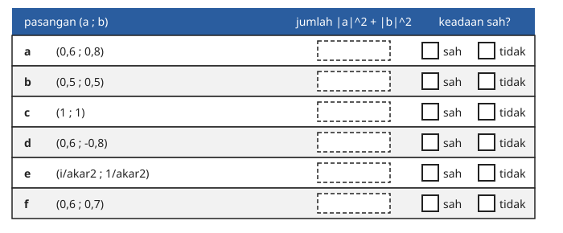

**Ingat dulu:** Tanpa melihat catatan, jawab. (1) Hitung modulus dan konjugat `3 + 4i`. ______ (2) Kapan hasil kali dalam dua vektor sama dengan nol, dan apa artinya? ______ (3) Apakah `A` kali `B` selalu sama dengan `B` kali `A` untuk dua matriks? Beri satu contoh. ______



`[Gambar: tabel enam baris berlabel a sampai f dengan pasangan amplitudo: (0,6 ; 0,8), (0,5 ; 0,5), (1 ; 1), (0,6 ; -0,8), (i/akar2 ; 1/akar2), dan (0,6 ; 0,7). Kolom jumlah |a|^2 + |b|^2 kosong, dan dua kotak berlabel sah dan tidak sah kosong untuk dicentang.]`

**Prediksi:** Pada gambar ada enam pasangan amplitudo untuk satu qubit. Sebelum menghitung, tebak dan tulis mana yang sah sebagai keadaan qubit ______ dan satu alasan umum untuk yang tidak sah ______ Lalu isi kolom jumlah dan centang sah atau tidak.

**Lengkapi:**

1. `(3, 4)`: jumlah kuadrat `3*3 + 4*4 = ____`, jadi bukan keadaan. Dinormalkan menjadi `(3/____ ; 4/____) = (____ ; ____)`.
2. Cari `b` bila `(0,8 ; b)` keadaan sah dan `b` positif: `b*b = 1 - 0,8*0,8 = ____`, jadi `b = ____`.
3. Isi `____` dengan nama fungsi atau nilai yang tepat.

```cpp setengah-jadi
bool sah(Kompleks a, Kompleks b) {
    double jumlah = std::____(a) + std::____(b);   // modulus kuadrat
    return std::fabs(jumlah - ____) < 1e-9;        // syarat normalisasi
}
```

**Susun:** Urutkan baris A sampai E menjadi perulangan pemeriksa keadaan. `AI: tanpa AI`

```text
(A) bool sah = std::fabs(jumlah - 1.0) < 1e-9;
(B) for (const Keadaan& k : daftar) {
(C) std::cout << k.nama << (sah ? " sah" : " TIDAK sah") << "\n";
(D) double jumlah = std::norm(k.a) + std::norm(k.b);
(E) }
```

Urutanku: ____ , ____ , ____ , ____ , ____

**Latihan:**

1. Periksa `(0,28 ; 0,96)`, `(0,5 ; 0,8)`, `(0 ; -1)`, dan `(0,6i ; 0,8)`. `AI: tanpa AI` ______
2. Jadikan `(1, 2)` dan `(1, -1)` keadaan sah dengan normalisasi, empat desimal. `AI: boleh` ______
3. Bila `a = 1/akar3` (kira-kira 0,5774) dan `b` positif real, berapa `b`? `AI: tanpa AI` ______
4. Apakah `((1 + i)/2 ; (1 - i)/2)` keadaan sah? ______

**Cek diri:**

- [ ] Saya dapat menyatakan syarat normalisasi.
- [ ] Saya dapat memeriksa dan memperbaiki pasangan amplitudo dengan normalisasi.
- [ ] Saya dapat menjelaskan bedanya keadaan dan hasil baca.

**Catatan cetak (untuk guru, tidak dicetak):** satu halaman A4, dicetak satu sisi. Kunci ada di modul `e-xi1-m5` bagian "Kunci dan petunjuk". Lembar tidak memuat kolom identitas (nama, kelas, tanggal, atau nilai).
