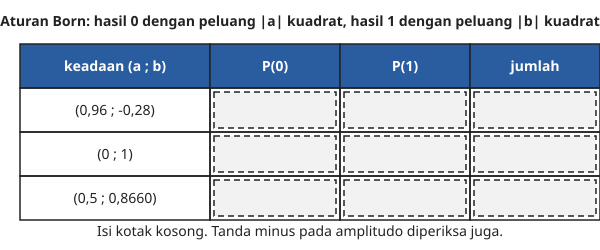

**Ingat dulu:** (1) Tulis `|0>` dan `|1>` sebagai vektor dan sebutkan syarat sebuah keadaan sah. (2) Pengacak klasik dua kali dan H dua kali dimulai dari 0: mengapa hasilnya berbeda?



`[Gambar: tabel empat kolom (keadaan, P(0), P(1), jumlah) dengan tiga baris keadaan: (0,96 ; -0,28), (0 ; 1), dan (0,5 ; 0,8660). Kotak P(0), P(1), dan jumlah dikosongkan; isi dengan aturan Born.]`

**Prediksi:** Qubit berada pada keadaan `(0,6 ; 0,8)`. Tebak dan tulis: (1) peluang membaca 0 dan peluang membaca 1: ______ dan ______; (2) peluang bila keadaannya `(0,6 ; -0,8)`: sama atau berbeda? ______

**Lengkapi:**

1. Keadaan `(0,28 ; 0,96)`: P(0) = `0,28*0,28` = ______ dan P(1) = `0,96*0,96` = ______. Jumlahnya ______.
2. Keadaan `(0,6 ; 0,8i)`: P(1) = `|0,8i|` kuadrat = ______.
3. Keadaan `(a ; 0,6)` dengan `a` positif: P(1) = ______, P(0) = ______, jadi `a` = ______.

**Susun:** Susun baris berikut menjadi isi perulangan pembuat keadaan acak (`x` diambil lebih dulu dari pembangkit). Tulis urutan hurufnya: ______

```text
(a) double a = x / panjang;
(b) double panjang = std::sqrt(x * x + y * y);
(c) double b = y / panjang;
(d) double y = 2.0 * (rng() / 4294967296.0) - 1.0;
(e) double x = 2.0 * (rng() / 4294967296.0) - 1.0;
```

**Latihan:**

1. (`AI: tanpa AI`) Isi tabel pada gambar.
2. (`AI: tanpa AI`) Normalkan `(3, -4)` menjadi keadaan, lalu hitung peluangnya.

   ______

3. (`AI: boleh`) Tulis pseudocode fungsi `peluang(a, b)` yang mengembalikan P(0) dan P(1) dan menolak masukan yang jumlahnya bukan 1 (dengan toleransi).

   ______

**Cek diri:**

- [ ] Saya dapat menghitung P(0) dan P(1) dari amplitudo.
- [ ] Saya dapat menjelaskan superposisi tanpa "0 dan 1 sekaligus".
- [ ] Saya dapat menunjukkan bahwa tanda minus tidak mengubah peluang pembacaan langsung.

**Catatan cetak (untuk guru, tidak dicetak):** satu sampai dua halaman A4, satu lembar per murid. Kunci ada di modul `e-xi1-m6` bagian "Kunci dan petunjuk". Lembar tidak memuat kolom identitas.
