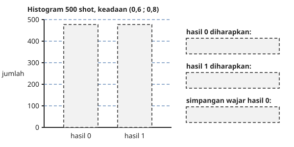

**Ingat dulu:** (1) Dari keadaan `(a, b)`, berapa peluang hasil 0 dan hasil 1? (2) Sebutkan satu hal yang dijanjikan komputasi kuantum dan satu hal yang bukan.



`[Gambar: kerangka histogram untuk 500 shot dari keadaan (0,6 ; 0,8). Sumbu tegak jumlah kemunculan 0 sampai 500, dua kolom kosong berlabel hasil 0 dan hasil 1. Di kanan, tiga kotak kosong: hasil 0 diharapkan, hasil 1 diharapkan, simpangan wajar hasil 0. Gambar batangnya dan isi kotaknya.]`

**Prediksi:** Qubit disiapkan pada `(0,6 ; 0,8)` lalu dibaca, diulang 1000 shot. Tebak: (1) kira-kira berapa kali hasil 0 dan hasil 1: ______ dan ______; (2) apakah hasilnya persis sama dengan perkiraanmu bila diulang 1000 shot lagi? ______ (3) bila keadaan itu dibaca dua kali berturut-turut tanpa disiapkan ulang, apakah hasil kedua pasti sama dengan hasil pertama? ______

**Lengkapi:**

1. Keadaan `(0,6 ; 0,8)`, 1000 shot: hasil 0 diharapkan 1000 x 0,36 = ______ kali, dan simpangan wajar `akar(1000 * 0,36 * 0,64)` kira-kira ______.
2. Program mencatat 361. Selisihnya dari harapan ______ kali, kira-kira ______ simpangan. Wajar? ______
3. Satu pembacaan dan perulangan shot:

```cpp setengah-jadi
// Satu shot: hasil 0 dengan peluang p0, selain itu 1.
int ukur(double p0) {
    return acak01() ____ p0 ? ____ : ____;
}

int nol = 0;
for (int i = 0; i < ____; i++) {      // n shot
    if (ukur(0.36) == ____) nol++;    // hitung hasil 0
}
```

**Susun:** Susun baris berikut (penjorokan dihilangkan) menjadi bagian pembuka program: pembangkit global, fungsi bilangan acak, lalu fungsi pembacaan. Urutan huruf: ______

```text
(a) int ukur(double p0) {
(b) return acak01() < p0 ? 0 : 1;
(c) }
(d) double acak01() {
(e) return rng() / 4294967296.0;
(f) }
(g) std::mt19937 rng(2026);
```

**Latihan:**

1. (`AI: tanpa AI`) Keadaan `(0,6 ; 0,8)`, 500 shot: kerjakan gambar di atas.
2. (`AI: tanpa AI`) Satu shot memberi hasil 0. Mengapa itu belum cukup untuk memastikan keadaannya `(0,6 ; 0,8)`? Beri satu keadaan lain yang mungkin menghasilkan 0.

   ______

3. (`AI: boleh`) Tulis pseudocode yang menerima peluang `p0` dan jumlah shot `n`, lalu mengembalikan histogram (jumlah hasil 0 dan hasil 1).

   ______

**Cek diri:**

- [ ] Saya dapat menjelaskan shot dan histogram.
- [ ] Saya dapat memperkirakan jumlah hasil dan kisaran wajarnya dari peluang.
- [ ] Saya dapat menjelaskan mengapa satu shot tidak cukup.

**Catatan cetak (untuk guru, tidak dicetak):** satu sampai dua halaman A4, satu lembar per murid. Kunci ada di modul `e-xi1-m7` bagian "Kunci dan petunjuk". Lembar tidak memuat kolom identitas.
