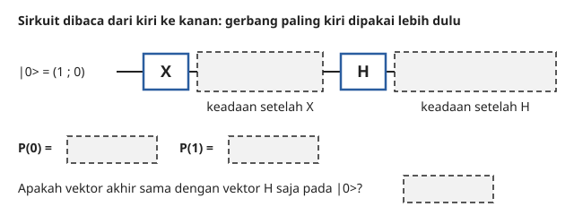

**Ingat dulu:** (1) Apakah `(0,5 ; 0,5)` keadaan sah? Jika bukan, bagaimana memperbaikinya? (2) Apa yang terjadi pada keadaan setelah dibaca, dan apa hasil pembacaan kedua pada keadaan yang sama? (3) Hitung matriks `[[0, 1], [1, 0]]` kali vektor `(3, 4)`.



`[Gambar: kawat dari |0> = (1 ; 0), gerbang X, lalu gerbang H. Setelah tiap gerbang ada kotak kosong untuk menulis keadaan. Di bawah ada kotak kosong untuk P(0), P(1), dan pertanyaan apakah vektor akhirnya sama dengan H saja pada |0>. Telusuri sirkuitnya.]`

**Prediksi:** Qubit mulai dari `|0>`, vektor `(1, 0)`. Tebak: (1) hasil X pada `|0>`: ______ (2) hasil H pada `|0>`: ______ (3) bila X dipakai lebih dulu lalu H, apakah peluang membaca 0 dan 1 sama dengan H saja? ______ Apakah vektor akhirnya juga sama? ______

**Lengkapi:**

1. Z pada `(0,6 ; 0,8)` memberi `(______ ; ______)`.
2. H pada `(1, 0)` memberi `(h ; ______)`, dan H pada `(0, 1)` memberi `(h ; ______)`.
3. Fungsi yang menerapkan matriks pada keadaan:

```cpp setengah-jadi
Keadaan terapkan(Matriks g, Keadaan k) {
    return {g.a * k.a0 + g.b * ____, g.c * ____ + g.d * ____};
}
```

**Susun:** Susun baris berikut (penjorokan dihilangkan) menjadi fungsi `jumlahKuadrat` yang benar. Urutan huruf: ______

```text
(a) double jumlahKuadrat(Keadaan k) {
(b) return k.a0 * k.a0 + k.a1 * k.a1;
(c) }
```

**Latihan:**

1. (`AI: tanpa AI`) Hitung H pada `(0,8 ; 0,6)`, lalu periksa bahwa jumlah kuadrat hasilnya 1.

   ______

2. (`AI: tanpa AI`) Hitung Z lalu X pada `|0>` dan X lalu Z pada `|0>`. Apakah vektornya sama? Apakah peluangnya sama?

   ______

3. (`AI: boleh`) Apakah `[[1, 0], [0, 2]]` dapat menjadi gerbang? Buktikan dengan `(0, 1)`.

   ______

**Cek diri:**

- [ ] Saya dapat menuliskan matriks X, Z, dan H.
- [ ] Saya dapat menerapkan dua gerbang berurutan dengan urutan yang benar.
- [ ] Saya dapat menjelaskan mengapa gerbang harus mempertahankan panjang vektor.

**Catatan cetak (untuk guru, tidak dicetak):** satu sampai dua halaman A4, satu lembar per murid. Kunci ada di modul `e-xi1-m8` bagian "Kunci dan petunjuk". Lembar tidak memuat kolom identitas.
