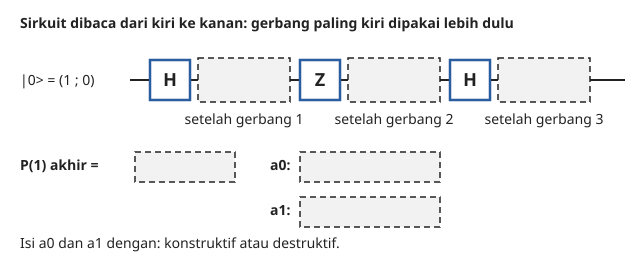

**Ingat dulu:** (1) Pengacak klasik dua kali dan H dua kali dimulai dari 0: mengapa hasilnya berbeda? (2) Pada keadaan `(0,6 ; 0,8)`, berapa peluang membaca 0, dan mengapa bukan 0,6?



`[Gambar: kawat dari |0> = (1 ; 0), gerbang H, gerbang Z, lalu gerbang H, dengan kotak kosong setelah tiap gerbang untuk menulis keadaan. Di bawah ada kotak kosong untuk P(1) akhir dan untuk jenis interferensi pada komponen a0 dan a1. Telusuri sirkuitnya.]`

**Prediksi:** Qubit mulai dari `|0>`. Tebak peluang membaca 1 untuk tiga sirkuit: (1) H saja: ______ (2) H lalu H: ______ (3) H, Z, lalu H: ______ Satu kalimat alasan untuk nomor 3: ______

**Lengkapi:**

1. Sirkuit H, X, H pada `|0>`: setelah H `(h, h)`; setelah X `(______ ; ______)`; setelah H `(______ ; ______)`. Peluang membaca 1: ______
2. Sirkuit X, H, H pada `|0>`: setelah X `(______ ; ______)`; setelah H `(h ; ______)`; setelah H kedua `(______ ; ______)`.
3. Satu matriks dari dua gerbang, `g1` dipakai lebih dulu:

```cpp setengah-jadi
Matriks sirkuit2 = kali(____, ____);  // g2 dipakai sesudah g1
```

**Susun:** Susun baris berikut (penjorokan dihilangkan) menjadi fungsi `telusuri` yang menerapkan tiap gerbang sirkuit pada keadaan awal `(1, 0)`. Urutan huruf: ______

```text
(a) void telusuri(const std::string& sirkuit) {
(b) Keadaan k = {1, 0};
(c) for (char g : sirkuit) {
(d) k = terapkan(gerbang(g), k);
(e) }
(f) }
```

**Latihan:**

1. (`AI: tanpa AI`) Telusuri H, X, H pada `|1>`. Tulis keadaan setelah tiap gerbang dan peluang membaca 1.

   ______

2. (`AI: tanpa AI`) Rancang sirkuit dari `|0>` yang membuat peluang membaca 1 sebesar 1, tanpa gerbang X. Buktikan dengan penelusuran.

   ______

3. (`AI: boleh`) Tebak peluang membaca 1 untuk H, Z, H, Z, H, lalu telusuri.

   ______

**Cek diri:**

- [ ] Saya dapat menelusuri sirkuit satu qubit dan menulis keadaan tiap langkah.
- [ ] Saya dapat menuliskan sirkuit sebagai satu matriks dengan urutan yang benar.
- [ ] Saya dapat menjelaskan interferensi konstruktif dan destruktif dengan angka.

**Catatan cetak (untuk guru, tidak dicetak):** satu sampai dua halaman A4, satu lembar per murid. Kunci ada di modul `e-xi1-m9` bagian "Kunci dan petunjuk". Lembar tidak memuat kolom identitas.
