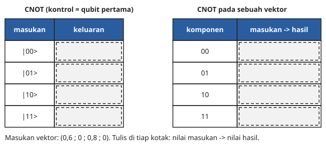

**Ingat dulu:** (1) Apa arti shot, dan mengapa satu shot tidak cukup untuk mengetahui keadaan? (2) Bagaimana menghitung keadaan produk dari (a, b) dan (c, d)? Beri contoh angka. (3) Tulis matriks X dan hitung X kali (1, 0).



`[Gambar: dua tabel berkotak kosong. Kiri: CNOT dengan qubit pertama sebagai kontrol, masukan |00>, |01>, |10>, |11> dan kolom keluaran kosong. Kanan: komponen 00, 01, 10, 11 untuk vektor masukan (0,6 ; 0 ; 0,8 ; 0) dengan kotak hasil kosong. Isi semua kotak.]`

**Prediksi:** Qubit pertama `|1>`, qubit kedua `|0>`, CNOT dengan qubit pertama sebagai kontrol. Tebak dan tulis: (1) keadaan sesudahnya: ______ (2) bila qubit pertama `|0>`: ______ (3) bila qubit pertama `(h, h)` dan qubit kedua `|0>`, apakah keadaan sesudahnya masih berupa produk dua qubit, dan mengapa? ______ (`h` = 1/akar2, kira-kira 0,7071.)

**Lengkapi:**

1. CNOT pada `|11>` memberi `|______>`; CNOT pada `|01>` memberi `|______>`.
2. CNOT pada `(0,6 ; 0 ; 0,8 ; 0)` memberi `(______ ; ______ ; ______ ; ______)`.
3. Matriks CNOT:

```cpp setengah-jadi
const Matriks CNOT = {
    {1, 0, 0, 0},
    {0, 1, 0, 0},
    {0, 0, ____, ____},
    {0, 0, ____, ____},
};
```

**Susun:** Susun baris berikut (penjorokan dan `}` penutup tidak diberikan) menjadi perulangan yang mencetak hasil CNOT pada empat keadaan dasar; baris (b) sampai (d) ada di dalam perulangan. Urutan huruf: ______

```text
(a) for (int i = 0; i < 4; i++) {
(b) Vektor dasar(4, 0.0);
(c) dasar[i] = 1.0;
(d) std::printf("CNOT |%s> = %s\n", nama[i], tulis(kali(CNOT, dasar)).c_str());
```

**Latihan:**

1. (`AI: tanpa AI`) Keadaan `(0 ; 0,6 ; 0 ; 0,8)` sah? Hitung CNOT kali keadaan itu, lalu peluang tiap hasil dua bit.

   ______

2. (`AI: tanpa AI`) Terapkan CNOT dua kali pada `(0,48 ; -0,36 ; 0,64 ; -0,48)` dan jelaskan mengapa hasilnya kembali semula.

   ______

3. (`AI: boleh`) Tulis pseudocode fungsi yang menerapkan CNOT pada vektor empat komponen tanpa membuat matriks.

   ______

**Cek diri:**

- [ ] Saya dapat menuliskan matriks CNOT dan menyebut kontrol serta targetnya.
- [ ] Saya dapat membuat tabel CNOT pada empat keadaan dasar.
- [ ] Saya dapat menjelaskan mengapa CNOT dua kali memberi keadaan semula.

**Catatan cetak (untuk guru, tidak dicetak):** satu sampai dua halaman A4, satu lembar per murid. Kunci ada di modul `e-xi2-m1` bagian "Kunci dan petunjuk". Lembar tidak memuat kolom identitas.
