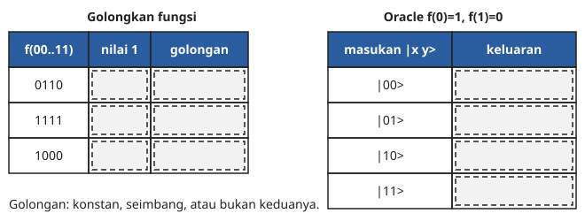

**Ingat dulu:** (1) Bagaimana satu bit kunci dipakai mengenkripsi satu bit pesan dengan XOR, dan bagaimana mendekripsinya? (2) Apa yang dilakukan CNOT pada qubit kedua bila qubit pertama 0, dan bila 1?



`[Gambar: dua tabel berkotak kosong. Kiri: fungsi dua bit 0110, 1111, dan 1000 dengan kolom banyak nilai 1 dan golongan. Kanan: oracle untuk f(0) = 1 dan f(1) = 0, memetakan |00>, |01>, |10>, |11> ke keluaran. Isi semua kotak.]`

**Prediksi:** Tebak dan tulis: (1) ada berapa fungsi dari 2 bit ke 1 bit, dan berapa yang konstan: ______ (2) apakah oracle untuk fungsi konstan reversibel? ______ (3) berapa kali kotak hitam harus ditanya agar pasti tahu fungsi dari 2 bit itu konstan atau seimbang, bila sudah dijamin salah satunya? ______

**Lengkapi:**

1. Untuk n = 2 ada 4 masukan dan `2^4` = ______ fungsi; fungsi seimbang punya ______ nilai 1.
2. Oracle untuk `f(0) = 1`, `f(1) = 0` memetakan `|1>|1>` ke `|1>|______>`.
3. Tabel oracle:

```cpp setengah-jadi
std::vector<int> tabel_oracle(int f0, int f1) {
    int f[2] = {f0, f1};
    std::vector<int> tujuan;
    for (int x = 0; x < 2; x++)
        for (int y = 0; y < 2; y++) tujuan.push_back(2 * x + (y ____ f[x]));
    return tujuan;
}
```

**Susun:** Susun baris berikut (penjorokan dan kurung kurawal penutup dihilangkan) menjadi fungsi `klasifikasi` (0 konstan, 1 seimbang, 2 lain). Urutan huruf: ______

```text
(a) int satu = 0;
(b) for (int i = 0; i < panjang; i++) satu += (f >> i) & 1;
(c) return 2;
(d) int klasifikasi(unsigned f, int panjang) {
(e) if (satu == panjang / 2) return 1;
(f) if (satu == 0 || satu == panjang) return 0;
```

**Latihan:**

1. (`AI: tanpa AI`) Golongkan `0110`, `1111`, dan `1000`: isi tabel kiri pada gambar.
2. (`AI: tanpa AI`) Untuk `f(0) = 1`, `f(1) = 0`, ke mana oracle memetakan `|00>`, `|01>`, `|10>`, dan `|11>`? Isi tabel kanan.
3. (`AI: boleh`) Tulis pseudocode strategi klasik: tanya masukan berurutan; kapan ia berhenti dan menjawab seimbang, dan kapan konstan?

   ______

**Cek diri:**

- [ ] Saya dapat menggolongkan fungsi Boolean menjadi konstan, seimbang, atau bukan keduanya.
- [ ] Saya dapat menulis oracle `U_f` dan menunjukkan ia reversibel.
- [ ] Saya dapat menghitung query klasik terburuk dengan rumus `2^(n-1) + 1`.

**Catatan cetak (untuk guru, tidak dicetak):** satu sampai dua halaman A4, satu lembar per murid. Kunci ada di modul `e-xi2-m10` bagian "Kunci dan petunjuk". Lembar tidak memuat kolom identitas.
