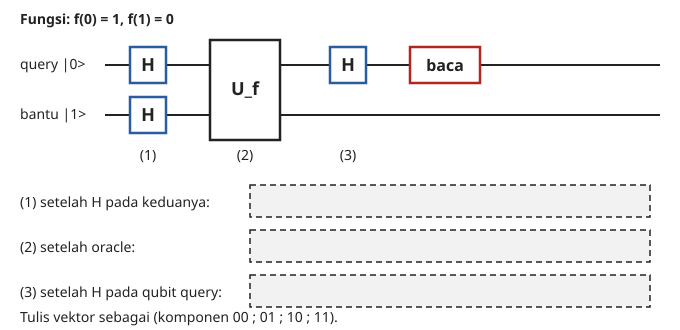

**Ingat dulu:** (1) Tuliskan efek oracle U_f pada |x, y>, dan mengapa U_f reversibel walau f konstan? (2) Mengapa H, baca, H memberi peluang 0 sebesar 0,5 sedangkan H, H memberi 1?



`[Gambar: dua kawat, qubit query mulai dari |0> dan qubit bantu mulai dari |1>. Urutan: H pada keduanya, oracle U_f, H pada qubit query, lalu baca qubit query. Di bawah ada tiga kotak kosong untuk vektor empat komponen (00 ; 01 ; 10 ; 11) setelah tiap tahap, untuk f(0) = 1 dan f(1) = 0.]`

**Prediksi:** Tebak dan tulis: (1) bila `f` konstan, hasil membaca qubit query pada akhir sirkuit: acak atau pasti? ______ (2) berapa kali oracle dipasang? ______ (3) apakah dari hasil itu kita tahu `f(0)` dan `f(1)` masing-masing? ______

**Lengkapi:**

1. Setelah H pada keduanya dari `(0; 1; 0; 0)`, vektornya `(______; ______; ______; ______)` (angka 0,5 dengan tanda).
2. Untuk `f(0) = 0` dan `f(1) = 0` oracle tidak mengubah vektor. H pada qubit query dari `(0,5; -0,5; 0,5; -0,5)` memberi `(______; ______; 0; 0)`.
3. Metode oracle:

```cpp setengah-jadi
Vektor pasang(const Vektor& v) {
    dipasang += ____;
    Vektor hasil(4, 0.0);
    for (int x = 0; x < 2; x++)
        for (int y = 0; y < 2; y++) hasil[2 * x + (y ____ f[x])] = v[2 * x + y];
    return hasil;
}
```

**Susun:** Susun baris berikut (penjorokan dihilangkan) menjadi isi metode `pasang`. Urutan huruf: ______

```text
(a) return hasil;
(b) for (int y = 0; y < 2; y++)
(c) Vektor hasil(4, 0.0);
(d) hasil[2 * x + (y ^ f[x])] = v[2 * x + y];
(e) for (int x = 0; x < 2; x++)
```

**Latihan:**

1. (`AI: tanpa AI`) Untuk `f(0) = 1`, `f(1) = 0`, isi tiga kotak pada gambar. Apa hasil bacaan dan kesimpulannya?

   ______

2. (`AI: tanpa AI`) Untuk `f(0) = 1`, `f(1) = 1`, tulis keadaan qubit query setelah oracle dengan rumus `(-1)^f(x)`, lalu setelah H. Apakah tanda minus global memengaruhi hasil?

   ______

3. (`AI: boleh`) Tulis pseudocode pemeriksa klasik yang pasti benar untuk fungsi satu bit, dan sebut berapa query yang ia pakai.

   ______

**Cek diri:**

- [ ] Saya dapat menelusuri empat langkah algoritma Deutsch pada vektor dua qubit.
- [ ] Saya dapat menjelaskan arti hasil bacaan 0 dan 1.
- [ ] Saya dapat menyebut batas klaim "satu query lawan dua".

**Catatan cetak (untuk guru, tidak dicetak):** satu sampai dua halaman A4, satu lembar per murid. Kunci ada di modul `e-xi2-m11` bagian "Kunci dan petunjuk". Lembar tidak memuat kolom identitas.
