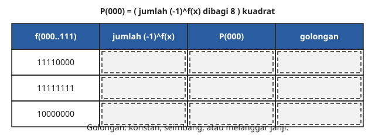

**Ingat dulu:** (1) Pada algoritma Deutsch, mengapa qubit bantu dimulai dari |1> lalu diberi H, dan apa keadaan qubit pertama sesudah oracle? (2) Berapa memori kira-kira untuk menyimpan vektor 30 qubit bila tiap amplitudo 8 byte?



`[Gambar: tabel dengan kolom f(000..111), jumlah (-1)^f(x), P(000), dan golongan. Tiga baris: 11110000, 11111111, dan 10000000. Isi kolom yang kosong dengan rumus ((jumlah)/8) kuadrat.]`

**Prediksi:** Tebak dan tulis: (1) peluang membaca `000` pada qubit query untuk `f` konstan: ______ dan untuk `f` seimbang: ______ (2) apa yang terjadi bila `f` melanggar janji, misalnya hanya satu nilai 1 dari delapan? ______ (3) berapa query klasik terburuk untuk n = 3? ______

**Lengkapi:**

1. Untuk n = 3 vektor memiliki ______ komponen (tiga qubit query dan satu qubit bantu). Fungsi `00001111` punya ______ nilai 1, jadi seimbang.
2. `P(000)` untuk seimbang `((4 - 4)/8)²` = ______; untuk konstan `((8 - 0)/8)²` = ______.
3. Sirkuit Deutsch-Jozsa:

```cpp setengah-jadi
double deutsch_jozsa(const Fungsi& f) {
    Vektor v(size_t(1) << N, 0.0);
    v[____] = 1.0;  // |000>|1>
    for (int k = 0; k < N; k++) gerbang_h(v, k);
    v = pasang_oracle(v, f);
    for (int k = 0; k < ____; k++) gerbang_h(v, k);  // H hanya pada qubit query
    return v[0] * v[0] + v[1] * v[1];
}
```

**Susun:** Susun baris berikut (penjorokan dan kurung kurawal penutup dihilangkan) menjadi pembuatan daftar fungsi yang memenuhi janji. Urutan huruf: ______

```text
(a) Fungsi f(8);
(b) janji.push_back(f);
(c) std::vector<Fungsi> janji = {konstan_0, konstan_1};
(d) if (__builtin_popcount(topeng) != 4) continue;
(e) for (int topeng = 0; topeng < 256; topeng++) {
(f) for (int x = 0; x < 8; x++) f[x] = (topeng >> x) & 1;
```

**Latihan:**

1. (`AI: tanpa AI`) Isi tabel pada gambar.
2. (`AI: tanpa AI`) Tulis tabel delapan nilai untuk: konstan 1; `f(x)` sama dengan bit terakhir `x`; dan `f(x) = 1` hanya bila dua bit pertama `x` sama dengan 1. Golongkan masing-masing.

   ______

3. (`AI: boleh`) Tulis pseudocode pemeriksa klasik acak: pilih `k` masukan acak, bertanya, jawab konstan bila semua sama. Berapa peluang ia salah pada fungsi seimbang?

   ______

**Cek diri:**

- [ ] Saya dapat menyebut langkah sirkuit Deutsch-Jozsa dan arti hasil bacaannya.
- [ ] Saya dapat menghitung `P(000)` dari jumlah `(-1)^f(x)`.
- [ ] Saya dapat menyebut batas keunggulan terhadap pemeriksa klasik acak.

**Catatan cetak (untuk guru, tidak dicetak):** satu sampai dua halaman A4, satu lembar per murid. Kunci ada di modul `e-xi2-m12` bagian "Kunci dan petunjuk". Lembar tidak memuat kolom identitas.
