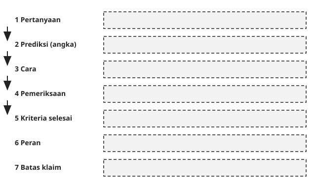

**Ingat dulu:** (1) Berapa fungsi Boolean dari 2 bit ke 1 bit, dan berapa yang konstan, seimbang, dan bukan keduanya? (2) Apa beda fase global dan fase relatif, dan mana yang mengubah peluang?

`[Gambar: kerangka rencana satu halaman berisi tujuh baris berlabel dengan kotak kosong: pertanyaan, prediksi (angka), cara, pemeriksaan, kriteria selesai, peran, dan batas klaim. Panah menunjukkan urutan dari pertanyaan sampai kriteria selesai. Isi untuk fenomenamu.]`

**Prediksi:** Pilih satu fenomena: keadaan Bell, teleportasi, atau Deutsch-Jozsa. Sebelum menulis kode, tulis prediksi angkamu (ditulis sebelum program dijalankan): ______

**Lengkapi:** Isi rencana pada gambar untuk fenomena yang kamu pilih, lalu tulis tiga pemeriksaan programmu:

1. Pemeriksaan 1: ______
2. Pemeriksaan 2: ______
3. Pemeriksaan 3: hasil shot dalam ______ simpangan wajar dari harapan.

**Latihan:** Uji gagal: tulis satu baris yang akan kamu rusak dengan sengaja, dan pemeriksaan mana yang seharusnya menangkapnya.

______

**Cek diri:**

- [ ] Saya menulis rencana dan prediksi sebelum menjalankan program.
- [ ] Saya menjalankan tiga pemeriksaan dan satu uji gagal.
- [ ] Poster saya menyatakan batas klaim dan memuat keluaran asli.
- [ ] Saya memberi dan menerima umpan balik sejawat.

**Catatan cetak (untuk guru, tidak dicetak):** satu halaman A4, satu lembar per murid. Bagian Susun dilewati karena modul proyek ini tidak memuat soal Parsons. Rujukan ada di modul `e-xi2-m13` bagian "Rencana proyek" dan "Daftar periksa". Lembar tidak memuat kolom identitas.
