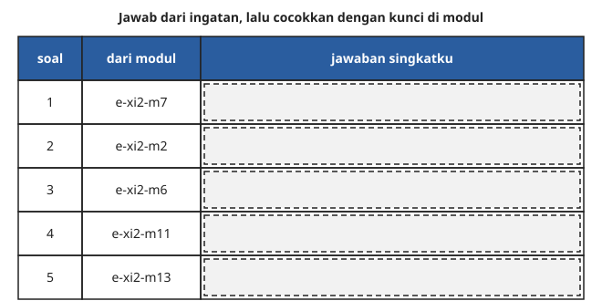

**Ingat dulu:** Jawab dari ingatan, tanpa melihat catatan, lalu isi tabel pada gambar.

1. Apa yang dipindahkan dan apa yang dikirim lewat kanal klasik pada teleportasi?
2. Bagaimana memeriksa bahwa vektor dua qubit tidak dapat difaktorkan? Beri contoh angka.
3. Tuliskan efek Toffoli pada `(a, b, 0)` dan jelaskan mengapa itu menghitung AND.
4. Apa yang dihitung hitungan "satu query lawan dua" pada algoritma Deutsch, dan apa yang tidak dibuktikannya tentang kecepatan komputer?
5. Apa tiga hal yang kamu cek sebelum mempercayai hasil simulasi proyekmu?

`[Gambar: tabel tiga kolom (soal, dari modul, jawaban singkatku) dengan lima baris. Soal 1 dari e-xi2-m7, soal 2 dari e-xi2-m2, soal 3 dari e-xi2-m6, soal 4 dari e-xi2-m11, soal 5 dari e-xi2-m13. Kotak jawaban dikosongkan; tulis jawaban singkatmu.]`

**Latihan:** Refleksi untuk dirimu sendiri, tidak diserahkan dan tidak dibagikan:

1. Apa yang sudah kamu kuasai di semester ini dan bagaimana buktinya? ______
2. Apa yang masih keliru atau membingungkan, dan soal mana yang menunjukkannya? ______
3. Rencana belajarmu sebelum `E-XII1-M1`: satu hal yang diulang, satu yang dicoba baru. ______
4. Satu klaim populer tentang komputasi kuantum yang sekarang kamu nilai lebih hati-hati, dan mengapa. ______

**Cek diri:**

- [ ] Saya dapat menelusuri sirkuit Bell dan teleportasi dengan tangan.
- [ ] Saya dapat menelusuri algoritma Deutsch dan membaca hasil Deutsch-Jozsa.
- [ ] Saya dapat menilai hasil simulasi dengan simpangan wajar dan menyebut batas klaimnya.

**Catatan cetak (untuk guru, tidak dicetak):** satu halaman A4, satu lembar per murid. Bagian Prediksi, Lengkapi, dan Susun dilewati karena modul asesmen ini tidak memuatnya. Kunci ada di modul `e-xi2-m14` bagian "Kunci dan petunjuk". Lembar tidak memuat kolom identitas.
