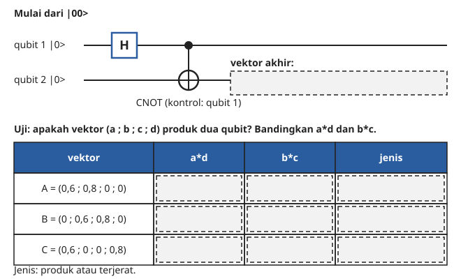

**Ingat dulu:** (1) Apa hasil CNOT pada keempat keadaan dasar `|00>`, `|01>`, `|10>`, `|11>`? (2) Tulis matriks H lalu hitung H kali (1, 0). (3) Bila hasil simulasi menyimpang dari prediksi, apa dua penyebab yang kamu periksa lebih dulu?



`[Gambar: atas, dua kawat qubit 1 dan qubit 2 dari |00>; H pada qubit 1, lalu CNOT dengan qubit 1 sebagai kontrol, dan kotak kosong untuk vektor akhir. Bawah, tabel vektor A = (0,6 ; 0,8 ; 0 ; 0), B = (0 ; 0,6 ; 0,8 ; 0), C = (0,6 ; 0 ; 0 ; 0,8) dengan kolom a*d, b*c, dan jenis (produk atau terjerat) kosong.]`

**Prediksi:** Mulai dari `|00>`, pasang H pada qubit pertama, lalu CNOT dengan qubit pertama sebagai kontrol. Tebak dan tulis: (1) keadaan akhirnya sebagai vektor empat komponen: ______ (2) hasil apa saja yang mungkin bila kedua qubit dibaca, dan peluangnya: ______ (3) apakah keadaan itu dapat ditulis sebagai produk dua qubit? ______

**Lengkapi:**

1. `(0,5 ; 0,5 ; 0,5 ; 0,5)` dapat difaktorkan bila `a*d` = ______ dan `b*c` = ______ sama; di sini keduanya ______.
2. Untuk `|Psi+> = (0 ; h ; h ; 0)`: `a*d` = ______, `b*c` = ______, jadi terjerat atau produk? ______
3. Uji faktorisasi:

```cpp setengah-jadi
bool bisa_difaktorkan(const Vektor& v) {
    return std::fabs(v[____] * v[____] - v[____] * v[____]) < 1e-9;
}
```

**Susun:** Susun baris berikut (penjorokan dihilangkan) menjadi pembangunan keadaan Bell dari `|00>`. Urutan huruf: ______

```text
(a) Vektor awal = {1, 0, 0, 0};
(b) Vektor sesudah_h = kali(H_PERTAMA, awal);
(c) Vektor bell = kali(CNOT, sesudah_h);
(d) std::printf("%s\n", tulis(bell).c_str());
```

**Latihan:**

1. (`AI: tanpa AI`) Periksa vektor A, B, dan C pada gambar sah (jumlah kuadrat 1), lalu isi tabel: produk atau terjerat.
2. (`AI: boleh`) Dari keadaan dasar mana H lalu CNOT menghasilkan `|Psi->`? Jelaskan dengan penelusuran komponen.

   ______

3. (`AI: boleh`) Tulis pseudocode yang menerima vektor empat komponen dan menjawab "produk" atau "terjerat". Mengapa perbandingan memakai toleransi kecil dan bukan `==`?

   ______

**Cek diri:**

- [ ] Saya dapat membangun `(h, 0, 0, h)` dari `|00>` dengan H dan CNOT.
- [ ] Saya dapat menjelaskan arti terjerat.
- [ ] Saya dapat memeriksa produk atau terjerat dengan `a*d` dan `b*c`.

**Catatan cetak (untuk guru, tidak dicetak):** satu sampai dua halaman A4, satu lembar per murid. Kunci ada di modul `e-xi2-m2` bagian "Kunci dan petunjuk". Lembar tidak memuat kolom identitas.
