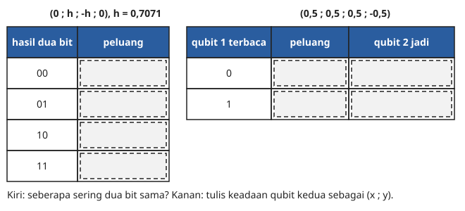

**Ingat dulu:** (1) Bagaimana membangun keadaan Bell `(h, 0, 0, h)` dari `|00>`, dan apa peluang tiap hasil dua bit? (2) Jika seribu shot dari peluang 0,5 memberi 515 hasil 0, apakah itu wajar? Beri kisarannya.



`[Gambar: dua tabel berkotak kosong. Kiri: keadaan (0 ; h ; -h ; 0), baris hasil dua bit 00, 01, 10, 11, kolom peluang. Kanan: keadaan (0,5 ; 0,5 ; 0,5 ; -0,5), baris qubit 1 terbaca 0 dan 1, kolom peluang dan keadaan qubit 2 sesudahnya. Isi semua kotak.]`

**Prediksi:** Keadaan Bell `(h, 0, 0, h)` dibaca 1000 shot. Tebak dan tulis: (1) hasil apa yang muncul dan berapa kali: ______ (2) bila hanya qubit pertama dibaca dan hasilnya 0, apa yang kamu ketahui tentang qubit kedua? ______ (3) apakah itu berarti qubit pertama "mengirim pesan"? ______

**Lengkapi:**

1. Keadaan `(0 ; h ; -h ; 0)`: peluang `01` = ______, `10` = ______, `00` = ______; dua bit selalu ______ (sama atau berbeda).
2. Untuk `(0,5 ; 0,5 ; 0,5 ; -0,5)`: peluang qubit pertama terbaca 0 = `0,5² + ______²` = ______.
3. Peluang qubit pertama terbaca 0:

```cpp setengah-jadi
double peluang_pertama_0(const Vektor& v) {
    return v[____] * v[____] + v[____] * v[____];
}
```

**Susun:** Susun baris berikut (penjorokan dan `}` penutup tidak diberikan; baris (b) sampai (d) ada di dalam perulangan) menjadi bagian fungsi `baca_pertama` yang menghitung keadaan qubit kedua. Urutan huruf: ______

```text
(a) for (int pertama = 0; pertama < 2; pertama++) {
(b) double a = v[2 * pertama], b = v[2 * pertama + 1];
(c) double peluang = a * a + b * b;
(d) double kedua0 = a / std::sqrt(peluang), kedua1 = b / std::sqrt(peluang);
```

**Latihan:**

1. (`AI: tanpa AI`) Untuk `(0,5 ; 0,5 ; 0,5 ; -0,5)`: isi tabel kanan, lalu tulis: produk atau terjerat? Jelaskan.

   ______

2. (`AI: tanpa AI`) Untuk `|Psi-> = (0 ; h ; -h ; 0)`: isi tabel kiri dan tulis seberapa sering dua bit sama. Terjerat?

   ______

3. (`AI: boleh`) Tulis pseudocode yang menghitung seberapa sering dua bit sama dari daftar pasangan hasil shot.

   ______

**Cek diri:**

- [ ] Saya dapat menghitung peluang hasil dua bit dari keadaan Bell.
- [ ] Saya dapat menghitung keadaan qubit kedua setelah qubit pertama dibaca.
- [ ] Saya dapat menjelaskan mengapa korelasi tidak mengirim pesan.

**Catatan cetak (untuk guru, tidak dicetak):** satu sampai dua halaman A4, satu lembar per murid. Kunci ada di modul `e-xi2-m3` bagian "Kunci dan petunjuk". Lembar tidak memuat kolom identitas.
