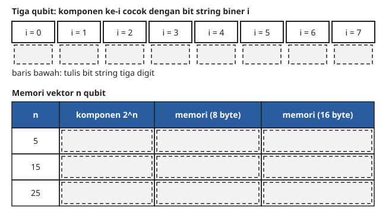

**Ingat dulu:** (1) Berapa hasil CNOT pada keadaan `(h, 0, h, 0)`, dengan qubit pertama sebagai kontrol? (2) Ada berapa bilangan dalam vektor keadaan satu qubit, dan ada berapa dalam matriks gerbangnya?



`[Gambar: atas, delapan kotak berindeks i = 0 sampai 7 untuk vektor tiga qubit, tiap kotak dengan ruang kosong di bawahnya untuk bit string tiga digit. Bawah, tabel n = 5, 15, 25 dengan kolom komponen 2^n, memori (8 byte), dan memori (16 byte) yang kosong. Isi semua kotak.]`

**Prediksi:** Tebak dan tulis: (1) berapa komponen untuk tiga qubit dan untuk sepuluh qubit: ______ dan ______ (2) berapa byte untuk vektor 30 qubit bila tiap amplitudo 8 byte: ______ (3) berapa kali lipat memori bertambah bila satu qubit ditambahkan: ______

**Lengkapi:**

1. Untuk empat qubit ada ______ komponen; komponen ke-9 adalah bit string `______` (biner 4 digit).
2. Untuk n = 5 dan 8 byte per amplitudo, memori `2^5 x 8` = ______ byte.
3. Keadaan GHZ tiga qubit (qubit 0 diberi H, lalu CNOT berantai):

```cpp setengah-jadi
Vektor v = keadaan_awal(3);
gerbang_satu(v, 3, H, ____);
cnot(v, 3, 0, ____);
cnot(v, 3, ____, 2);
```

**Susun:** Susun baris berikut (penjorokan dan `}` penutup tidak diberikan; baris (b) sampai (d) ada di dalam fungsi) menjadi fungsi yang membuat keadaan awal n qubit. Urutan huruf: ______

```text
(a) Vektor keadaan_awal(int n) {
(b) Vektor v(size_t(1) << n, 0.0);
(c) v[0] = 1.0;
(d) return v;
```

**Latihan:**

1. (`AI: tanpa AI`) Isi tabel memori pada gambar.
2. (`AI: tanpa AI`) Untuk tiga qubit, tulis pasangan indeks yang digabung oleh H pada qubit 0 dan pada qubit 2.

   ______

3. (`AI: boleh`) Tulis pseudocode keadaan GHZ untuk n qubit (H pada qubit 0, lalu CNOT dari qubit k ke k+1).

   ______

**Cek diri:**

- [ ] Saya dapat menjelaskan mengapa vektor n qubit punya `2^n` komponen.
- [ ] Saya dapat menghitung memori `2^n x 8` byte.
- [ ] Saya dapat membangun keadaan GHZ tiga qubit dengan H dan dua CNOT.

**Catatan cetak (untuk guru, tidak dicetak):** satu sampai dua halaman A4, satu lembar per murid. Kunci ada di modul `e-xi2-m4` bagian "Kunci dan petunjuk". Lembar tidak memuat kolom identitas.
