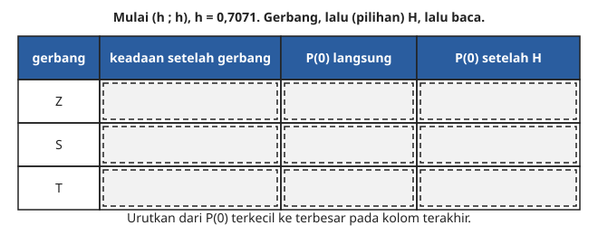

**Ingat dulu:** (1) Apa beda `(h, 0, 0, h)` dan `(h, 0, 0, -h)`, dan apakah peluang hasilnya berbeda? (2) Saat jumlah shot membesar, apa yang terjadi pada selisih mutlak dan pada selisih relatif terhadap harapan?



`[Gambar: tabel dengan baris gerbang Z, S, dan T pada keadaan (h ; h). Kolom: keadaan setelah gerbang, P(0) langsung, dan P(0) setelah H dipasang lagi; semua sel hasil kosong. Isi tabel.]`

**Prediksi:** Keadaan `(h, h)` diberi gerbang Z, S, atau T. Tebak dan tulis: (1) peluang membaca 0 tepat setelah tiap gerbang itu, tanpa gerbang lain: ______ (2) bila H dipasang lagi sebelum dibaca, apakah ketiganya masih sama? Urutkan dari peluang 0 terkecil ke terbesar: ______

**Lengkapi:**

1. `S` kali `S` = gerbang ______; sebabnya `i` kali `i` = ______.
2. `Ry(theta)` pada `|0>` memberi `(______ , ______)`; untuk `theta` = 180 derajat hasilnya `(______ , ______)`.
3. Matriks Ry:

```cpp setengah-jadi
Matriks ry(double sudut) {
    double c = std::cos(sudut / 2), s = std::sin(sudut / 2);
    return {{c, ____}, {____, c}};
}
```

**Susun:** Susun baris berikut (penjorokan dihilangkan) menjadi pemeriksaan bahwa `S kali S = Z`. Urutan huruf: ______

```text
(a) Matriks hasil = kali_matriks(S, S);
(b) std::printf("S kali S = Z : %s\n", benar(sama(hasil, Z)));
```

**Latihan:**

1. (`AI: tanpa AI`) Hitung H, S, H pada `|0>` langkah demi langkah, lalu peluang tiap hasil.

   ______

2. (`AI: tanpa AI`) Tunjukkan dengan perkalian matriks bahwa `T T = S` dan bahwa `S S = Z`. Lalu sebutkan satu urutan gerbang yang sama dengan X.

   ______

3. (`AI: boleh`) Tulis pseudocode yang menerima peluang p dan mengembalikan sudut `theta` agar `Ry(theta)|0>` memberi peluang 1 sebesar p. Uji dengan p = 0,64.

   ______

**Cek diri:**

- [ ] Saya dapat menjelaskan fase global dan fase relatif.
- [ ] Saya dapat menunjukkan bahwa `S S = Z` dan `H Z H = X`.
- [ ] Saya dapat menghitung sudut Ry untuk peluang tertentu.

**Catatan cetak (untuk guru, tidak dicetak):** satu sampai dua halaman A4, satu lembar per murid. Kunci ada di modul `e-xi2-m5` bagian "Kunci dan petunjuk". Lembar tidak memuat kolom identitas.
