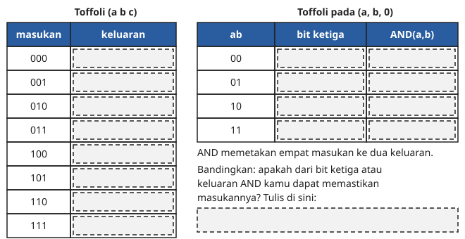

**Ingat dulu:** (1) Apa hasil gerbang S dua kali, dan apa kebalikan (invers) Z? (2) Apakah `(0,5 ; 0,5 ; 0,5 ; 0,5)` dapat difaktorkan? Tunjukkan dengan `a*d` dan `b*c`.



`[Gambar: kiri, tabel Toffoli dengan masukan 000 sampai 111 dan kolom keluaran kosong. Kanan, tabel untuk masukan (a, b, 0) dengan empat pasangan ab, kolom bit ketiga dan AND(a, b) kosong, serta satu kotak kosong untuk jawaban tentang masukan yang dapat dipastikan. Isi semua kotak.]`

**Prediksi:** Gerbang AND klasik mengubah dua bit menjadi satu bit. Toffoli menerima tiga bit `a, b, c` dan membalik `c` hanya bila `a` dan `b` keduanya 1. Tebak dan tulis: (1) bila keluaran AND adalah 0, dapatkah kamu memastikan masukannya? ______ (2) keluaran Toffoli untuk `110`: ______ dan untuk `111`: ______ (3) bila bit ketiga dimulai dari 0, apa yang dihitung bit ketiga setelah Toffoli? ______

**Lengkapi:**

1. Toffoli pada `101` memberi `______`; pada `110` memberi `______`.
2. NOT dari Toffoli: bila `a = 1` dan `b = 1`, `c` menjadi ______ dari `c`.
3. Gerbang Toffoli:

```cpp setengah-jadi
int toffoli(int x) {
    int a = (x >> 2) & 1, b = (x >> 1) & 1, c = x & 1;
    return (a << 2) | (b << 1) | (c ^ (____ & ____));
}
```

**Susun:** Susun baris berikut (penjorokan dihilangkan) menjadi pemeriksaan bahwa Toffoli adalah kebalikan dirinya sendiri. Urutan huruf: ______

```text
(a) std::printf("Toffoli dua kali = semula: %s\n", semua ? "benar" : "salah");
(b) if (toffoli(toffoli(x)) != x) semua = false;
(c) bool semua = true;
(d) for (int x = 0; x < 8; x++)
```

**Latihan:**

1. (`AI: tanpa AI`) Isi tabel kiri pada gambar, lalu tunjukkan bahwa `111` lalu Toffoli lalu Toffoli kembali ke `111`.

   ______

2. (`AI: tanpa AI`) Isi tabel kanan pada gambar. Lalu tunjukkan bagaimana Toffoli dengan `a = b = 1` bertindak sebagai NOT pada `c`.

   ______

3. (`AI: boleh`) Apakah OR dua bit reversibel? Hitung berapa masukan memberi keluaran 0 dan berapa keluaran 1, dan simpulkan.

   ______

**Cek diri:**

- [ ] Saya dapat menjelaskan arti reversibel dan memeriksanya pada tabel.
- [ ] Saya dapat menjelaskan mengapa AND tidak reversibel.
- [ ] Saya dapat membuat AND dari Toffoli.

**Catatan cetak (untuk guru, tidak dicetak):** satu sampai dua halaman A4, satu lembar per murid. Kunci ada di modul `e-xi2-m6` bagian "Kunci dan petunjuk". Lembar tidak memuat kolom identitas.
