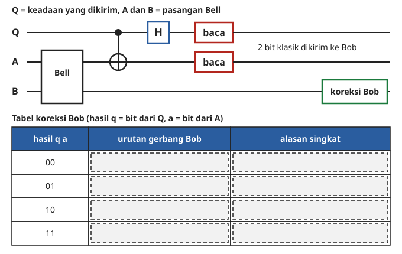

**Ingat dulu:** (1) Mengapa hasil pengukuran satu qubit terjerat tidak dapat dipakai mengirim pesan lebih cepat dari cahaya? (2) Apa arti gerbang reversibel? Beri satu contoh gerbang kuantum dan satu gerbang klasik yang reversibel.



`[Gambar: tiga kawat Q, A, dan B. A dan B berada pada keadaan Bell. CNOT dengan Q sebagai kontrol dan A sebagai target, lalu H pada Q, lalu Q dan A dibaca; dua bit klasik dikirim ke Bob yang mengoreksi B. Di bawah, tabel empat hasil q a (00, 01, 10, 11) dengan kolom urutan gerbang Bob dan alasan singkat yang kosong. Isi tabel.]`

**Prediksi:** Qubit pertama `(0,6 ; 0,8)`, qubit kedua `|0>`, lalu CNOT. Tebak dan tulis: (1) apakah hasilnya salinan `(0,6 ; 0,8)` kali `(0,6 ; 0,8)`? ______ (2) apakah Alice cukup mengirim dua bit klasik kepada Bob agar Bob memegang qubit yang sama, tanpa pasangan terjerat? ______ (3) setelah teleportasi, apakah Alice masih memegang keadaan semula? ______

**Lengkapi:**

1. Salinan `(a, b)` kali `(a, b)` = `(a², ______, ______, b²)`; untuk `(0,8 ; -0,6)` = `(0,64 ; ______ ; ______ ; 0,36)`.
2. Hasil CNOT pada `(0,8 ; -0,6)` kali `|0>` = `(______ ; 0 ; 0 ; ______)`.
3. Koreksi Bob:

```cpp setengah-jadi
if (a == 1) std::swap(bob[____], bob[____]);  // hasil qubit A
if (q == 1) bob[1] = ____ * bob[1];            // hasil qubit Q
```

**Susun:** Susun baris berikut (penjorokan dihilangkan) menjadi koreksi Bob. Urutan huruf: ______

```text
(a) if (a == 1)
(b) std::swap(bob[0], bob[1]);
(c) if (q == 1)
(d) bob[1] = -bob[1];
```

**Latihan:**

1. (`AI: tanpa AI`) Hitung CNOT pada `(0,8 ; -0,6)` kali `|0>`, bandingkan dengan salinan `(0,64 ; -0,48 ; -0,48 ; 0,36)`, dan periksa produk atau terjerat.

   ______

2. (`AI: tanpa AI`) Pada teleportasi `(0,6 ; 0,8)`, hasil Alice `01` dan Bob memegang `(0,8 ; 0,6)`: gerbang apa dan hasilnya? Ulangi untuk hasil `11` dengan Bob `(-0,8 ; 0,6)`.

   ______

3. (`AI: boleh`) Tulis pseudocode aturan koreksi Bob dari dua bit `(q, a)`: gerbang apa, urutan apa.

   ______

**Cek diri:**

- [ ] Saya dapat menunjukkan bahwa CNOT tidak menyalin `(0,6 ; 0,8)` dan menyebut argumen kelinearannya.
- [ ] Saya dapat menyebut tiga langkah teleportasi.
- [ ] Saya dapat menjelaskan mengapa teleportasi tidak lebih cepat dari cahaya.

**Catatan cetak (untuk guru, tidak dicetak):** satu sampai dua halaman A4, satu lembar per murid. Kunci ada di modul `e-xi2-m7` bagian "Kunci dan petunjuk". Lembar tidak memuat kolom identitas.
