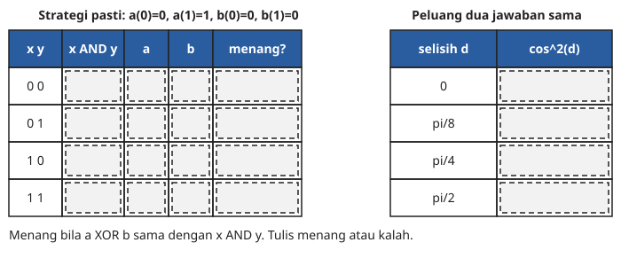

**Ingat dulu:** (1) Mengapa teleportasi tidak melanggar batas kecepatan cahaya? (2) Apa hasil rotasi Ry(theta) pada `|0>`, dan berapa peluang membaca 1? (3) Bagaimana memeriksa bahwa vektor dua qubit tidak dapat difaktorkan? Beri contoh angka.



`[Gambar: kiri, tabel empat pasangan pertanyaan x y dengan kolom x AND y, a, b, dan menang? kosong, untuk strategi pasti a(0) = 0, a(1) = 1, b(0) = 0, b(1) = 0. Kanan, tabel selisih sudut d = 0, pi/8, pi/4, pi/2 dengan kolom cos^2(d) kosong. Isi kedua tabel.]`

**Prediksi:** Tebak dan tulis: (1) peluang menang terbaik dua pemain klasik yang tidak boleh berbicara: ______ (2) apakah satu pasang qubit terjerat dapat membuat mereka menang 100 persen? ______ (3) apakah peluang jawaban Alice berubah bila pertanyaan Bob diganti? ______

**Lengkapi:**

1. Pertanyaan `(1, 1)`, jawaban `a = 1` dan `b = 0`: `a XOR b` = ______, `x AND y` = ______, jadi mereka ______ (menang atau kalah).
2. Untuk selisih sudut `pi/8`: `cos²(pi/8) = (1 + cos(pi/4))/2` = ______ (empat desimal).
3. Dua fungsi:

```cpp setengah-jadi
bool menang(int x, int y, int a, int b) {
    return (a ____ b) == (x ____ y);
}

// p = {P(00), P(01), P(10), P(11)}, indeks i = 2a + b
double peluang_menang(const Vektor& p, int x, int y) {
    double pm = 0.0;
    for (int i = 0; i < 4; i++)
        if (((i >> 1) ____ (i & 1)) == (x & y)) pm += p[i];
    return pm;
}
```

**Susun:** Susun baris berikut (penjorokan dihilangkan) menjadi perhitungan rata-rata menang. Urutan huruf: ______

```text
(a) std::printf("%.4f\n", total);
(b) for (int y = 0; y < 2; y++)
(c) double total = 0;
(d) for (int x = 0; x < 2; x++)
(e) total += peluang_menang(semua[x][y], x, y) / 4;
```

**Latihan:**

1. (`AI: tanpa AI`) Isi tabel kiri pada gambar: di pasangan pertanyaan mana strategi itu menang, dan berapa dari 4?
2. (`AI: tanpa AI`) Pada keadaan Bell, peluang dua jawaban sama adalah `cos²(d)` untuk selisih sudut `d`. Isi tabel kanan pada gambar.
3. (`AI: boleh`) Tulis pseudocode satu putaran: wasit memilih `x` dan `y`, pemain menjawab dari peluang, wasit memutuskan.

   ______

**Cek diri:**

- [ ] Saya dapat menyebut aturan menang CHSH dan menunjukkan mengapa strategi pasti paling banyak menang 3/4.
- [ ] Saya dapat menjelaskan mengapa permainan ini bukan alat komunikasi.
- [ ] Saya dapat menyebut batas simulasi di komputer klasik.

**Catatan cetak (untuk guru, tidak dicetak):** satu sampai dua halaman A4, satu lembar per murid. Kunci ada di modul `e-xi2-m8` bagian "Kunci dan petunjuk". Lembar tidak memuat kolom identitas.
