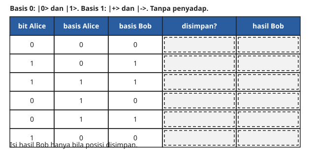

**Ingat dulu:** (1) Mengapa pengukuran tidak reversibel, padahal gerbang kuantum reversibel? (2) Apa yang terjadi pada keadaan setelah dibaca, dan apa hasil pembacaan kedua pada keadaan yang sama?



`[Gambar: tabel enam posisi dengan kolom bit Alice, basis Alice, basis Bob, disimpan?, dan hasil Bob. Kombinasi bit, basis Alice, basis Bob: 0 0 0; 1 0 1; 1 1 1; 0 1 0; 0 1 1; 1 0 0. Kolom disimpan? dan hasil Bob kosong. Basis 0 memakai |0> dan |1>, basis 1 memakai |+> dan |->. Isi tabel tanpa penyadap.]`

**Prediksi:** Tebak dan tulis: (1) seberapa sering basis Alice dan Bob sama bila keduanya memilih acak: ______ (2) tanpa penyadap, berapa persen bit tersaring tidak cocok: ______ (3) berapa persen bila ada penyadap yang membaca di basis acak lalu mengirim ulang: ______

**Lengkapi:**

1. Alice memilih bit 1 dan basis 1, jadi qubitnya `|______>` (`|+>` atau `|->`). Bob membaca di basis 1 dan memperoleh hasil ______.
2. Kesalahan di kunci tersaring akibat Eve: ______ x ______ = ______.
3. Dua fungsi:

```cpp setengah-jadi
Qubit siapkan(int bit, int basis) {
    Qubit q = bit == 0 ? Qubit{1.0, 0.0} : Qubit{0.0, 1.0};
    return basis == ____ ? gerbang_h(q) : q;
}

bool disimpan(int basis_a, int basis_b) {
    return basis_a ____ basis_b;
}
```

**Susun:** Susun baris berikut (penjorokan dan kurung kurawal penutup dihilangkan) menjadi isi satu putaran perulangan: pilih nilai acak, siapkan qubit, baca, lalu simpan bila basis sama. Urutan huruf: ______

```text
(a) int hasil = baca(q, basis_b);
(b) Qubit q = siapkan(bit, basis_a);
(c) int bit = acak_bit(), basis_a = acak_bit(), basis_b = acak_bit();
(d) if (basis_a == basis_b) {
(e) h.tersaring++;
```

**Latihan:**

1. (`AI: tanpa AI`) Alice mengirim bit 1 di basis 0 dan Bob membaca di basis 1. Hitung peluang Bob memperoleh 0 (terapkan H pada `(0, 1)` lalu baca), dan apakah posisi itu disimpan.

   ______

2. (`AI: tanpa AI`) Isi tabel pada gambar.
3. (`AI: tanpa AI`) Dengan penyadap, tiap bit yang dibandingkan lolos (cocok) dengan peluang 3/4. Berapa peluang 20 bit yang dibandingkan lolos semua? Paling sedikit berapa bit agar peluang lolos di bawah 1 persen?

   ______

**Cek diri:**

- [ ] Saya dapat menelusuri empat langkah BB84 pada tabel bit sintetis.
- [ ] Saya dapat menjelaskan mengapa penyadap menimbulkan kesalahan sekitar 25 persen.
- [ ] Saya dapat menyebut dua batas QKD dan batas simulasi ini.

**Catatan cetak (untuk guru, tidak dicetak):** satu sampai dua halaman A4, satu lembar per murid. Kunci ada di modul `e-xi2-m9` bagian "Kunci dan petunjuk". Lembar tidak memuat kolom identitas.
