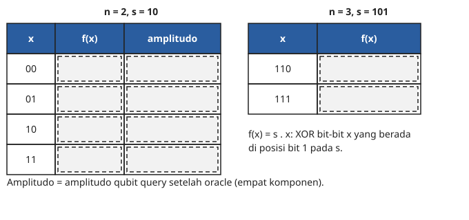

**Ingat dulu:** Tanpa melihat catatan, jawab. (1) Apa yang dipindahkan dan apa yang dikirim lewat kanal klasik pada teleportasi? ______ (2) Pada Deutsch-Jozsa, bila semua n qubit query terbaca 0 apa artinya, dan bila ada satu yang terbaca 1? ______ (3) Apa kerja oracle bit pada `|x>|y>`, dan apa yang terjadi bila dipasang dua kali? ______



`[Gambar: dua tabel. Kiri: n = 2 dan s = 10, empat masukan 00, 01, 10, 11 dengan kolom f(x) dan amplitudo (amplitudo qubit query setelah oracle, empat komponen) yang kosong. Kanan: n = 3 dan s = 101, masukan 110 dan 111 dengan kolom f(x) kosong. Di bawah tabel kanan tertulis cara menghitung f(x) = s . x: XOR bit-bit x yang berada di posisi bit 1 pada s.]`

**Prediksi:** Tebak dan tulis sebelum menghitung lebih jauh. Untuk `s = 101` dan `n = 3`: (1) apa yang kamu harapkan terbaca pada tiga qubit query setelah sirkuit Deutsch-Jozsa dipasang pada `f` ini? ______ (2) berapa query yang diperlukan algoritma klasik? ______ (3) apa yang terjadi bila `f` tidak berbentuk `s . x`? ______

**Lengkapi:**

1. Untuk `s = 101`, isi `f(110)` dan `f(111)` pada tabel kanan di gambar.
2. Setelah oracle dan H pada qubit query, bacaan qubit query untuk `s = 101` adalah string ____, bukan `000`.
3. Lengkapi:

```cpp setengah-jadi
Fungsi dari_rahasia(int s) {  // f(x) = s . x mod 2
    Fungsi f(size_t(1) << ____);
    for (int x = 0; x < (1 << n); x++) f[x] = paritas(s ____ x);  // AND bit demi bit
    return f;
}
```

**Susun:** Urutkan baris A sampai E menjadi isi fungsi `sirkuit` sampai oracle dan H kedua selesai. `AI: tanpa AI`.

```text
(A) v = pasang_oracle(v, f);
(B) for (int k = 0; k < n; k++) gerbang_h(v, k);
(C) v[1] = 1.0;
(D) for (int k = 0; k < N; k++) gerbang_h(v, k);
(E) Vektor v(size_t(1) << N, 0.0);
```

Urutan: ______ ______ ______ ______ ______

**Latihan:**

1. `AI: tanpa AI` Untuk `n = 2`, `s = 10`: isi `f` pada tabel kiri di gambar; tulis amplitudo qubit query setelah oracle; lalu telusuri H pada kedua qubit dan baca hasilnya. ______
2. `AI: boleh` Fungsi tiga bit `f = 01011010` (nilai pada `000` sampai `111` berurutan) memenuhi janji. Temukan `s` dengan tiga query klasik, lalu periksa lima nilai lainnya. ______
3. `AI: boleh` Tulis pseudocode yang memeriksa, dengan menelusuri semua `2^n` masukan, apakah sebuah tabel `f` memenuhi janji Bernstein-Vazirani untuk `s` dari tiga query klasik tadi. ______
4. Tiga fungsi dari tiga bit: konstan 1 (`11111111`), bit pertama (`00001111`), dan XOR semua bit (`01101001`). Mana yang memenuhi janji Bernstein-Vazirani, dan mana yang memenuhi janji Deutsch-Jozsa? ______
5. Berapa byte memori simulator untuk 20 qubit query dan satu qubit bantu bila tiap amplitudo 8 byte? ______

**Cek diri:**

- [ ] Saya dapat menghitung `f(x) = s . x` untuk `s` dan `x` yang diberikan.
- [ ] Saya dapat menelusuri `n = 2` dengan tangan.
- [ ] Saya dapat menyebut batas perbandingan satu query lawan `n` query.

**Catatan cetak (untuk guru, tidak dicetak):** dua halaman A4. Kunci ada di modul `e-xii1-m1`, bagian "Kunci dan petunjuk". Lembar tidak memuat kolom identitas.
