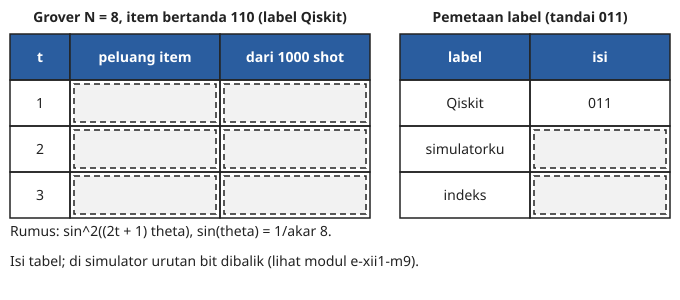

**Ingat dulu:** (1) Pada keadaan seragam empat item dengan satu item bertanda, mengapa pembacaan langsung masih `0,25` untuk tiap item? (2) Mengapa simulatormu menulis `100` untuk hasil yang di Qiskit ditulis `001`?



`[Gambar: kiri, tabel Grover N = 8 dengan baris t = 1, 2, 3 dan kolom peluang item serta dari 1000 shot, sel kosong. Kanan, tabel pemetaan label: baris Qiskit (isi 011), simulatorku dan indeks (kosong). Isi kotak kosong.]`

**Prediksi:** Grover tiga qubit (`N = 8`), item bertanda berlabel Qiskit `110`, 1000 shot. Tebak dan tulis: (1) peluang item bertanda setelah `t = 2` dan kira-kira berapa dari 1000 shot membacanya: ______ (2) peluang setelah `t = 3`: ______ (3) bila shot dinaikkan menjadi 10.000, apakah peluangnya berubah, dan apa yang berubah? ______

**Lengkapi:**

1. Oracle untuk menandai `101` (label Qiskit): bit pada qubit 1 adalah 0, jadi `qc.x(______)`, `qc.ccz(0, 1, 2)`, `qc.x(______)`.
2. Fungsi `balik_rata`:

```cpp setengah-jadi
void balik_rata(Vektor& a) {
    double jumlah = 0.0;
    for (double x : a) jumlah += x;
    double rata = jumlah / double(a.____());
    for (double& x : a) x = 2.0 * ____ - x;
}
```

**Susun:** Susun baris berikut (kurung kurawal penutup dihilangkan) menjadi bagian akhir `main` di simulatormu. Urutan huruf: ______

```text
(a)         balik_rata(a);
(b)     for (int t = 1; t <= 3; t++) {
(c)         balik_fase(a, bertanda);
(d)         std::printf("t = %d: peluang %.4f\n", t, a[bertanda] * a[bertanda]);
(e)     Vektor a(N, 1.0 / std::sqrt(double(N)));
```

**Latihan:**

1. (`AI: tanpa AI`) Dengan `sin(theta) = 1/akar 8`, hitung peluang item bertanda untuk `t = 1, 2, 3` dengan rumus `sin²((2t + 1) theta)`; isi tabel kiri pada gambar.
2. (`AI: boleh`) Tandai item `011` (label Qiskit). Tulis perubahan pada oracle, lalu isi tabel kanan pada gambar.

   ______

3. (`AI: tanpa AI`) Mengapa `t = 3` lebih buruk daripada `t = 2`, dan apa yang dihitung sebagai query pada contoh ini?

   ______

**Cek diri:**

- [ ] Saya dapat menunjuk oracle dan pembalikan rata-rata pada kode Grover Qiskit.
- [ ] Saya dapat menghitung peluang item bertanda untuk `t` tertentu.
- [ ] Saya dapat menukar label Qiskit dan indeks simulatorku.

**Catatan cetak (untuk guru, tidak dicetak):** satu sampai dua halaman A4, satu lembar per murid. Kunci ada di modul `e-xii1-m10` bagian "Kunci dan petunjuk". Lembar tidak memuat kolom identitas.
