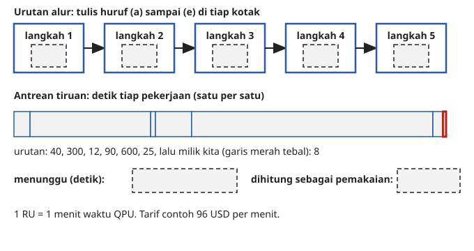

**Ingat dulu:** (1) Apa yang dihitung sebagai query pada pencarian Grover, dan apa yang tidak dihitung? (2) Bila satu gerbang bersih dengan peluang 0,99, berapa peluang 100 gerbang bersih, dan mengapa turunnya secepat itu?



`[Gambar: atas, lima kotak langkah 1 sampai 5 berpanah, tiap kotak berisi ruang kosong untuk huruf langkah yang cocok. Bawah, antrean tiruan tujuh pekerjaan (40, 300, 12, 90, 600, 25 detik, lalu milik kita 8 detik, garis merah tebal) dengan dua kotak kosong: menunggu (detik) dan dihitung sebagai pemakaian. Catatan: 1 RU = 1 menit waktu QPU, tarif contoh 96 USD per menit.]`

**Prediksi:** Antrean karangan untuk satu perangkat berisi enam pekerjaan orang lain, lalu pekerjaan kita (lihat gambar). Tebak dan tulis: (1) berapa detik sampai hasil kita tiba bila antrean berjalan satu per satu: ______ (2) berapa detik yang dihitung sebagai pemakaian kita: ______ (3) berapa pekerjaan 8 detik muat dalam jatah 10 menit: ______ (4) biaya satu pekerjaan 8 detik bila tarifnya 96 USD per menit: ______

**Lengkapi:**

1. Pekerjaan 20 detik sama dengan ______ RU; pada 96 USD per menit biayanya ______ USD.
2. Hitungan RU dan jatah:

```cpp setengah-jadi
double ru_satu = milik / ____;  // 1 RU = 1 menit = 60 detik
int jumlah = int(jatah_menit / ____);
```

**Susun:** Susun baris berikut (kurung kurawal penutup dihilangkan) menjadi bagian awal `main` pada program antrean. Urutan huruf: ______

```text
(a)     double tunggu = 0.0;
(b)     for (size_t i = 0; i + 1 < durasi.size(); i++) tunggu += durasi[i];
(c)     double milik = durasi.back();
(d)     std::vector<double> durasi = {40, 300, 12, 90, 600, 25, 8};
(e)     std::printf("menunggu %.0f detik\n", tunggu);
```

**Latihan:**

1. (`AI: tanpa AI`) Urutkan alur pada gambar dengan huruf: (a) histogram diterima; (b) sirkuit ditulis; (c) pekerjaan menunggu antrean; (d) sirkuit dikompilasi ke gerbang perangkat; (e) pekerjaan dieksekusi di perangkat. Isi kotak langkah 1 sampai 5.
2. (`AI: boleh`) Pekerjaan 20 detik pada tarif 96 USD per menit: berapa RU, berapa USD, dan berapa pekerjaan seperti itu dalam jatah 10 menit?

   ______

3. (`AI: tanpa AI`) Tulis lima pertanyaan yang harus dijawab ketentuan layanan sebelum sekolah membuat akun.

   ______

**Cek diri:**

- [ ] Saya dapat menggambar alur cloud quantum dan menyebut tiap langkahnya.
- [ ] Saya dapat membedakan waktu tunggu dari pemakaian dan menghitung biaya contoh.
- [ ] Saya tahu mengapa tidak ada akun murid dan token tidak boleh ada di berkas.

**Catatan cetak (untuk guru, tidak dicetak):** satu sampai dua halaman A4, satu lembar per murid. Kunci ada di modul `e-xii1-m11` bagian "Kunci dan petunjuk". Lembar tidak memuat kolom identitas.
