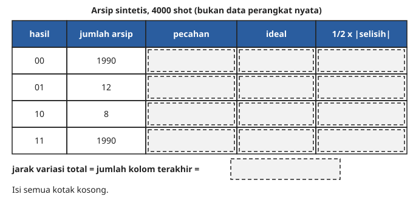

**Ingat dulu:** (1) Berapa amplitudo yang harus disimpan simulator untuk `n` qubit, dan apa akibatnya bagi `n = 30`? (2) Sebutkan lima langkah alur cloud quantum berurutan dan tandai mana yang dihitung sebagai pemakaian.



`[Gambar: tabel arsip sintetis 4000 shot dengan hasil 00, 01, 10, 11 dan jumlah arsip 1990, 12, 8, 1990. Kolom pecahan, ideal, dan 1/2 x |selisih| kosong; di bawahnya satu kotak kosong untuk jarak variasi total. Ini bukan data perangkat nyata. Isi semua kotak.]`

**Prediksi:** Sebelum guru menunjukkan hasil, tebak dan tulis untuk sirkuit Bell dengan 4000 shot pada perangkat nyata: (1) hasil apa saja yang muncul: ______ (2) apakah `01` dan `10` persis nol? ______ (3) kira-kira berapa persen shot berupa hasil terlarang (`01` atau `10`), dalam rentang tebakan: ______

**Lengkapi:**

1. Bagian hasil terlarang dari arsip: `(106 + 86) / 4000` = ______.
2. Jarak variasi total:

```cpp setengah-jadi
double frak = arsip[i] / double(____);
tvd += 0.5 * std::fabs(frak - ____[i]);
```

**Susun:** Susun baris berikut menjadi bagian penghitung jarak variasi total pada `main`. Urutan huruf: ______

```text
(a)     for (int i = 0; i < 4; i++) {
(b)         double frak = arsip[i] / double(shot);
(c)         tvd += 0.5 * std::fabs(frak - ideal[i]);
(d)     }
(e)     std::printf("jarak variasi total = %.4f\n", tvd);
(f)     double tvd = 0.0;
```

**Latihan:**

1. (`AI: boleh`) Isi tabel pada gambar: pecahan tiap hasil, peluang ideal, dan jarak variasi total.
2. (`AI: tanpa AI`) Sebut dua sumber hasil terlarang `01` dan `10`, dan mana yang lebih besar pada contoh di modul.

   ______

3. (`AI: boleh`) Rancang lembar pengamatan satu halaman untuk demonstrasi: apa yang dicatat dan apa yang tidak boleh dicatat.

   ______

**Cek diri:**

- [ ] Saya dapat menyebut langkah demonstrasi dan data yang tidak boleh dicatat.
- [ ] Saya dapat menghitung jarak variasi total dari dua histogram.
- [ ] Saya tahu arsip di modul ini sintetis, bukan data perangkat nyata.

**Catatan cetak (untuk guru, tidak dicetak):** satu sampai dua halaman A4, satu lembar per murid. Kunci ada di modul `e-xii1-m12` bagian "Kunci dan petunjuk". Lembar tidak memuat kolom identitas.
