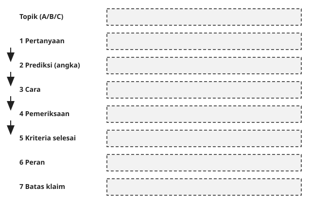

**Ingat dulu:** (1) Mengapa percepatan kuadrat dari Grover bukan percepatan eksponensial? (2) Mengapa hasil `01` dan `10` muncul pada perangkat nyata tetapi tidak pada simulator ideal? (3) Pada kode Grover Qiskit, bagian mana oracle dan bagian mana pembalikan terhadap rata-rata?

`[Gambar: kerangka rencana satu halaman berisi delapan baris berlabel dengan kotak kosong: topik (A, B, atau C), pertanyaan, prediksi (angka), cara, pemeriksaan, kriteria selesai, peran, dan batas klaim. Panah menunjukkan urutan dari pertanyaan sampai kriteria selesai. Isi untuk topik yang kamu pilih.]`

**Prediksi:** Pilih satu topik: (A) cocokkan model derau Bell dengan histogram demonstrasi atau arsip; (B) bandingkan Grover `N = 8` ideal, berderau, dan dari Qiskit lokal; (C) kurva H, tunggu, H terhadap waktu tunggu. Tulis prediksi angkamu sebelum program dijalankan: ______

**Lengkapi:** Isi rencana pada gambar, lalu tulis tiga pemeriksaan programmu:

1. Pemeriksaan 1: ______
2. Pemeriksaan 2: ______
3. Pemeriksaan 3: jarak terbaik dibandingkan dengan jarak akibat ______ terbatas.

**Latihan:** Uji gagal: tulis satu baris yang akan kamu ubah dengan sengaja, dan pemeriksaan mana yang seharusnya menangkapnya.

______

**Cek diri:**

- [ ] Saya menulis rencana dan prediksi sebelum menjalankan program.
- [ ] Saya menjalankan tiga pemeriksaan dan satu uji gagal.
- [ ] Laporan saya menyatakan sumber data dan batas klaim.
- [ ] Saya memberi dan menerima umpan balik sejawat.

**Catatan cetak (untuk guru, tidak dicetak):** satu halaman A4, satu lembar per murid. Bagian Susun dilewati karena modul proyek ini tidak memuat soal Parsons. Rujukan ada di modul `e-xii1-m13` bagian "Rencana proyek" dan "Daftar periksa". Lembar tidak memuat kolom identitas.
