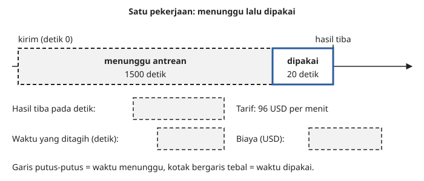

**Ingat dulu:** Tanpa melihat catatan, jawab (`AI: tanpa AI`). (1) Mengapa transformasi Fourier berguna untuk menemukan periode? ______ (2) Mengapa waktu menunggu antrean tidak sama dengan pemakaian yang ditagih? ______ (3) Sebutkan tiga pertanyaan untuk menguji klaim berita bahwa komputer kuantum "lebih cepat". ______

`[Gambar: garis waktu satu pekerjaan. Dari kiri: kirim pada detik 0, bagian putus-putus "menunggu antrean 1500 detik", lalu kotak bergaris tebal "dipakai 20 detik", lalu hasil tiba. Di bawahnya tiga kotak kosong: hasil tiba pada detik, waktu yang ditagih dalam detik, dan biaya dalam USD pada tarif 96 USD per menit.]`

**Prediksi:** Tambahkan kesalahan baca `r = 0,03` pada Bell 1000 shot di simulatormu. Prediksi jumlah hasil terlarang beserta rentang tiga simpangan, sebelum menjalankan. ______

**Latihan:** Kerjakan tanpa AI dan tulis langkahmu (`AI: tanpa AI`).

1. Grover: untuk `N = 32` dengan satu item bertanda, berapa pengulangan terbaik dan peluang item bertanda, dan berapa query klasik terburuk? ______
2. Derau: sebuah sirkuit memuat 50 gerbang dengan peluang bersih 0,99 per gerbang. Berapa peluang tanpa kesalahan, dan berapa gerbang paling sedikit agar peluang itu di bawah 0,5? Pada H, tunggu 6 langkah, H dengan `q = 0,05`, berapa `P(0)`? ______
3. Histogram: Bell 1000 shot memberi `00` = 470, `01` = 28, `10` = 24, `11` = 478. Hitung jarak variasi total terhadap simulator ideal, `z` untuk `00`, dan jelaskan asal hasil `01` dan `10`. ______
4. Cloud: sebuah pekerjaan 20 detik menunggu 1500 detik; tarif 96 USD per menit. Isi tiga kotak pada gambar, lalu hitung berapa RU dipakai dan berapa pekerjaan seperti itu dalam jatah 10 menit. ______
5. Klaim kritis. Berita: "Komputer kuantum di cloud memecahkan sandi bank dalam hitungan detik dengan algoritma Shor." Nilai dalam tiga kalimat. ______

**Cek diri:**

- [ ] Saya dapat menghitung peluang Grover dan memilih jumlah pengulangan.
- [ ] Saya dapat menilai histogram berderau dengan rumus dan simpangan wajar.
- [ ] Saya dapat menilai klaim berita dengan tiga pertanyaan penguji.

**Catatan cetak (untuk guru, tidak dicetak):** dua halaman A4. Kunci ada di modul `e-xii1-m14`, bagian "Kunci dan petunjuk". Lembar tidak memuat kolom identitas.
