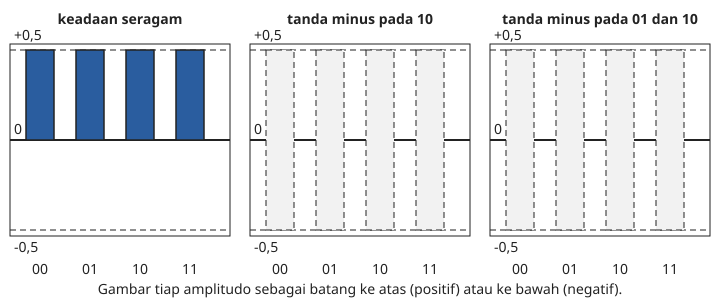

**Ingat dulu:** Tanpa melihat catatan, jawab. (1) Apa janji pada masalah Bernstein-Vazirani, dan berapa query klasik yang diperlukan untuk string rahasia `n` bit? ______ (2) Pada keadaan Bell, berapa peluang dua hasil sama bila arah baca kedua qubit berselisih sudut pi/8? ______ (3) Bagaimana membandingkan hasil 1000 shot dengan peluang hitungan tangan memakai simpangan wajar? ______



`[Gambar: tiga diagram batang untuk hasil 00, 01, 10, 11. Tiap diagram punya garis tengah 0 dan garis batas +0,5 serta -0,5. Diagram kiri, "keadaan seragam", berisi empat batang ke atas setinggi 0,5. Diagram tengah "tanda minus pada 10" dan diagram kanan "tanda minus pada 01 dan 10" kosong; gambar tiap amplitudo sebagai batang ke atas (positif) atau ke bawah (negatif).]`

**Prediksi:** Keadaan seragam dua qubit adalah `(0,5; 0,5; 0,5; 0,5)`. Tebak dan tulis: (1) setelah tanda minus pada `|11>` saja, berapa peluang tiap hasil bila langsung dibaca? ______ (2) bila lalu H dipasang pada kedua qubit, apakah hasilnya masih `00`, atau berubah? ______ (3) apa yang terjadi bila tanda minus ada pada `|01>` dan `|11>` sekaligus? ______

**Lengkapi:**

1. Tanda minus pada `|10>` mengubah `(0,5; 0,5; 0,5; 0,5)` menjadi `(____)`. Gambar batangnya pada diagram tengah.
2. Lengkapi:

```cpp setengah-jadi
    Vektor u = {0.5, 0.5, 0.5, 0.5};
    u[____] = -u[____];  // pembalikan fase langsung pada |11>
    // ... di dalam perulangan: qubit bantu tetap |->
    double harap = u[x] * (y == 0 ? H1 : ____);
```

**Susun:** Urutkan baris A sampai E menjadi isi fungsi `pasang_oracle`. Kurung kurawal penutup perulangan sengaja dihilangkan.

```text
(A) Vektor baru(v.size(), 0.0);
(B) size_t x = i >> 1, y = i & 1;
(C) baru[(x << 1) | (y ^ f[x])] = v[i];
(D) return baru;
(E) for (size_t i = 0; i < v.size(); i++) {
```

Urutan: ______ ______ ______ ______ ______

**Latihan:**

1. `AI: tanpa AI` Tanda minus pada `|00>` dan `|01>` saja. Tulis vektornya, ubah menjadi `-1` kali vektor yang sudah kamu kenal, lalu tebak hasil setelah H pada kedua qubit. ______
2. `AI: tanpa AI` Tanda minus pada `|01>` dan `|10>`. Gambar batangnya pada diagram kanan, tebak hasil setelah H pada kedua qubit, lalu hitung dengan rumus `b_y = (1/2) x jumlah (-1)^(x.y) a_x`. ______
3. `AI: boleh` Tulis pseudocode fungsi `sama_hingga_fase_global(a, b)` untuk vektor real: benar bila `a` sama dengan `b` atau dengan `-b`. ______
4. Untuk tanda minus pada `|11>`, berapa harapan dan simpangan wajar bila 1000 shot dibaca langsung dan hasil `00` dihitung? ______

**Cek diri:**

- [ ] Saya dapat menyebut beda fase global dan fase relatif.
- [ ] Saya dapat menjelaskan mengapa oracle bit dengan `|->` menjadi oracle fase.
- [ ] Saya dapat menggambar diagram amplitudo untuk dua qubit.

**Catatan cetak (untuk guru, tidak dicetak):** dua halaman A4. Kunci ada di modul `e-xii1-m2`, bagian "Kunci dan petunjuk". Lembar tidak memuat kolom identitas.
