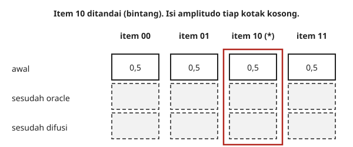

**Ingat dulu:** (1) Mengapa tanda minus pada seluruh keadaan tidak dapat dibedakan, sedangkan tanda minus pada sebagian amplitudo dapat? (2) Mengapa keadaan |0> dan |+> tidak dapat dibedakan dengan pasti oleh satu pembacaan?

______



`[Gambar: tabel empat kolom item 00, 01, 10, 11 dan tiga baris: awal (semua 0,5), sesudah oracle, dan sesudah difusi. Item 10 ditandai bintang dan dilingkari. Dua baris terakhir kosong; isi amplitudo tiap kotak.]`

**Prediksi:** Ada empat item `00`, `01`, `10`, `11`, dan satu ditandai oleh oracle. Tebak: (1) peluang membaca item ditandai setelah H saja ______; (2) peluang itu bila oracle fase dipasang sekali lalu langsung dibaca ______; (3) query klasik terburuk untuk memastikan item yang mana ______; (4) peluang item ditandai sesudah satu pengulangan Grover ______.

**Lengkapi:** (1) Pada pencarian klasik empat item, bila tiga item pertama kosong maka item ke-____ pasti item bertanda. (2) Isi bagian kosong.

```cpp setengah-jadi
void difusi(Vektor& v) {
    for (int k = 0; k < N; k++) gerbang_h(v, k);
    tanda_semua_kecuali_nol(v);
    for (int k = 0; k < ____; k++) gerbang_h(v, k);
}

void oracle_fase(Vektor& v, int ditandai) { v[ditandai] = -v[____]; }
```

**Susun:** Susun baris berikut menjadi pencarian Grover dengan `ulangan` pengulangan. Kurung kurawal penutup sengaja dihilangkan. Urutan: ______

```text
(a) for (int t = 0; t < ulangan; t++) {
(b)     oracle_fase(v, m);
(c)     difusi(v);
(d) Vektor v = seragam();
(e) double p = v[m] * v[m];
```

**Latihan:**

1. (`AI: tanpa AI`) Untuk tiap item ditandai `m` dari `00` sampai `11`, tulis vektor setelah oracle. ______
2. (`AI: tanpa AI`) Pencarian klasik memeriksa urutan `11`, `10`, `01`, lalu menyimpulkan `00`. Berapa query untuk tiap letak item, dan berapa rata-ratanya? ______
3. (`AI: boleh`) Perpanjang perulangan sampai `t = 5` untuk item `10`. Tebak dulu pola peluangnya, lalu jalankan. ______

**Cek diri:**

- [ ] Saya dapat menyatakan masalah pencarian tak terurut dan peran oracle.
- [ ] Saya dapat menyebut langkah satu pengulangan Grover.
- [ ] Saya dapat menelusuri empat item dengan satu item bertanda.

**Catatan cetak (untuk guru, tidak dicetak):** satu sampai dua halaman A4. Kunci ada di modul `e-xii1-m3` bagian "Kunci dan petunjuk". Lembar tidak memuat kolom identitas.
