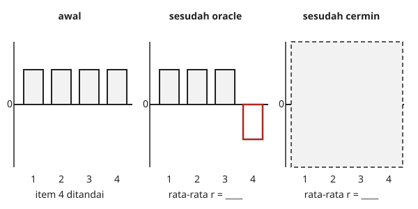

**Ingat dulu:** (1) Dengan empat item dan satu item bertanda, berapa pengulangan Grover yang membuat peluang item bertanda 1, dan berapa peluangnya setelah dua pengulangan? (2) Mengapa jumlah query klasik terburuk untuk membedakan fungsi konstan dari seimbang pada `n` bit adalah `2^(n-1) + 1`?

______



`[Gambar: tiga panel batang untuk empat item dengan item keempat ditandai. Panel awal berisi empat batang sama tinggi 0,5. Panel sesudah oracle: item keempat di bawah garis nol. Panel sesudah cermin kosong untuk digambar. Tiap panel punya isian rata-rata r.]`

**Prediksi:** (1) Pada tiga item (model aritmetika) dengan satu item bertanda, rata-rata amplitudo setelah oracle ______; apakah peluang item bertanda sesudah satu cermin mencapai 1? ______ (2) Pada empat item, amplitudo tiap item sesudah satu pengulangan ______. (3) Pada delapan item, apakah peluang item bertanda terus naik pada pengulangan ketiga dan keempat? ______

**Lengkapi:** (1) Untuk `(0,5; 0,5; -0,5; 0,5)`: jumlah = ____, rata-rata `r` = ____, dan `2r - (-0,5)` = ____. (2) Isi bagian kosong.

```cpp setengah-jadi
void balik_rata(Vektor& a) {
    double jumlah = 0.0;
    for (double x : a) jumlah += x;
    double rata = jumlah / a.size();
    for (double& x : a) x = ____ * rata - x;
}
```

**Susun:** Susun baris berikut menjadi isi fungsi `balik_rata`. Penjorokan dan kurung kurawal penutup sengaja dihilangkan. Urutan: ______

```text
(a) double rata = jumlah / a.size();
(b) for (double x : a) jumlah += x;
(c) for (double& x : a) x = 2.0 * rata - x;
(d) double jumlah = 0.0;
```

**Latihan:**

1. (`AI: tanpa AI`) Tiga item, item pertama ditandai. Telusuri satu pengulangan dengan pecahan dan hitung peluang item bertanda. ______
2. (`AI: tanpa AI`) Empat item, item keempat ditandai. Gambar diagram amplitudo pada gambar untuk awal, sesudah oracle, dan sesudah cermin.
3. (`AI: boleh`) Ubah menjadi lima item (model aritmetika). Prediksi dulu peluang setelah satu dan dua pengulangan, lalu jalankan. ______

**Cek diri:**

- [ ] Saya dapat menulis cermin terhadap rata-rata dan menghitungnya untuk empat amplitudo.
- [ ] Saya dapat menelusuri tiga dan empat item dengan tangan.
- [ ] Saya dapat menjelaskan mengapa pengulangan berlebih merugikan.

**Catatan cetak (untuk guru, tidak dicetak):** satu sampai dua halaman A4. Kunci ada di modul `e-xii1-m4` bagian "Kunci dan petunjuk". Lembar tidak memuat kolom identitas.
