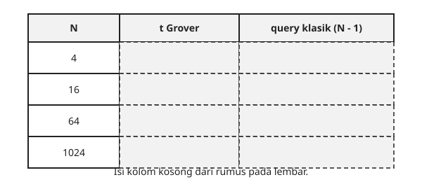

**Ingat dulu:** (1) Tuliskan operasi cermin terhadap rata-rata pada amplitudo `a_i`. (2) Apa efek oracle bit dengan qubit bantu `|->` pada keadaan `|x>`?

______



`[Gambar: tabel tiga kolom: N, t Grover, dan query klasik (N - 1). Baris N bernilai 4, 16, 64, dan 1024 sudah terisi; dua kolom lain kosong untuk diisi.]`

**Prediksi:** (1) Jumlah pengulangan terbaik untuk `N = 1024` ______. (2) Perkiraan untuk `N = 1.048.576` ______. (3) Bila `N` menjadi empat kali, jumlah pengulangan menjadi ____ kali. (4) Bila pengulangan ditambah jauh melewati yang terbaik, yang terjadi ______.

**Lengkapi:** (1) Untuk `N = 16`: `sin(theta)` = ____ dan `t` = bulatkan `pi/(4 theta) - 1/2` = ____. (2) Isi bagian kosong.

```cpp setengah-jadi
long ulangan_terbaik(long banyak) { return std::lround(PI / (4.0 * sudut(banyak)) - ____); }

double peluang_rumus(long banyak, long t) {
    double s = std::sin((____ * double(t) + 1.0) * sudut(banyak));
    return s * s;
}
```

**Susun:** Susun baris berikut menjadi isi fungsi `simulasi`. Kurung kurawal penutup perulangan sengaja dihilangkan. Urutan: ______

```text
(a) size_t ditandai = banyak / 3;
(b) balik_rata(a);
(c) for (long i = 0; i < t; i++) {
(d) Vektor a(banyak, 1.0 / std::sqrt(double(banyak)));
(e) size_t banyak = size_t(1) << n;
(f) return a[ditandai] * a[ditandai];
(g) balik_fase(a, ditandai);
```

**Latihan:**

1. (`AI: tanpa AI`) Untuk `N = 16`, `theta` kira-kira 14,48°. Hitung peluang setelah `t = 2` dan `t = 3`, dan pilih yang terbaik. ______
2. (`AI: tanpa AI`) Untuk `N = 1.000.000`, perkirakan `t` dan berapa kali lebih sedikit dari query klasik terburuk 999.999. ______
3. (`AI: boleh`) Ubah program agar dua item bertanda pada `N = 1024`. Prediksi dulu `t` terbaik, lalu jalankan. ______
4. (`AI: tanpa AI`) Isi tabel pada gambar untuk keempat `N` dengan rumus `t` kira-kira `pi/(4 theta) - 1/2`.

**Cek diri:**

- [ ] Saya dapat menghitung `theta` dan `t` terbaik untuk `N` tertentu.
- [ ] Saya dapat membandingkan `t` dengan query klasik `N - 1`.
- [ ] Saya dapat menjelaskan mengapa percepatannya kuadrat dan bukan eksponensial.

**Catatan cetak (untuk guru, tidak dicetak):** satu sampai dua halaman A4. Kunci ada di modul `e-xii1-m5` bagian "Kunci dan petunjuk". Lembar tidak memuat kolom identitas.
