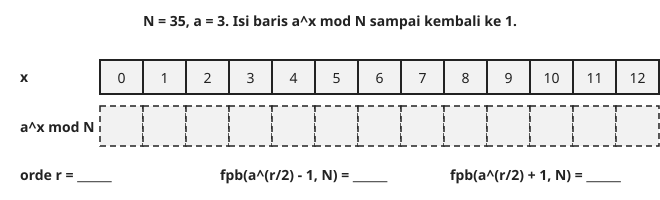

**Ingat dulu:** (1) Berapa pengulangan Grover yang mendekati terbaik untuk `N = 1024`, dan berapa query klasik terburuk? (2) Mengapa Grover tidak "memeriksa semua item sekaligus lalu membaca jawabannya"?

______



`[Gambar: tabel dua baris. Baris x berisi 0 sampai 12; baris a^x mod N kosong untuk N = 35 dan a = 3. Di bawahnya tiga isian: orde r, fpb(a^(r/2) - 1, N), dan fpb(a^(r/2) + 1, N).]`

**Prediksi:** (1) Untuk `N = 15` dan `a = 7`, periode barisan `7^x mod 15` ______. (2) Faktor yang muncul ______. (3) Barisan 0/1 berperiode 4 sepanjang 16: transformasi Fourier-nya besar di indeks ______. (4) Apakah `N = 15` memerlukan komputer kuantum? ______

**Lengkapi:** (1) Untuk `N = 21`, `a = 2`: barisan `2^x mod 21` adalah `1, 2, 4, 8, 16, 11, 1`, jadi `r` = ____; `2^3` = ____; `fpb(7, 21)` = ____ dan `fpb(9, 21)` = ____. (2) Isi bagian kosong.

```cpp setengah-jadi
long fpb(long a, long b) {
    while (b != 0) {
        long sisa = a % b;
        a = ____;
        b = sisa;
    }
    return a;
}
```

**Susun:** Susun baris berikut menjadi isi fungsi `orde`. Penjorokan dan kurung kurawal penutup sengaja dihilangkan. Urutan: ______

```text
(a) r++;
(b) long r = 1;
(c) nilai = (nilai * a) % N;
(d) return r;
(e) while (nilai != 1) {
(f) long nilai = a % N;
```

**Latihan:**

1. (`AI: tanpa AI`) Untuk `N = 35` dan `a = 3`, isi tabel pada gambar sampai kembali ke 1, tentukan `r`, lalu cari faktor dengan `fpb`. ______
2. (`AI: boleh`) Prediksi dulu, lalu jalankan `coba_faktor` untuk `a = 4` dan `a = 11` pada `N = 15`, dan untuk `a = 3` pada `N = 35`. ______
3. (`AI: tanpa AI`) Baca halaman IBM Quantum Learning "Shor's algorithm". Tulis tiga kalimat: bagian mana yang klasik, bagian mana yang kuantum, dan apa yang direduksi ke apa. ______

**Cek diri:**

- [ ] Saya dapat menyebut orde `r` dan menghitungnya untuk `N` kecil.
- [ ] Saya dapat memakai `fpb` untuk mendapat faktor dari `r` genap.
- [ ] Saya dapat menunjuk bagian klasik dan kuantum dari ide Shor.

**Catatan cetak (untuk guru, tidak dicetak):** satu sampai dua halaman A4. Kunci ada di modul `e-xii1-m6` bagian "Kunci dan petunjuk". Lembar tidak memuat kolom identitas.
