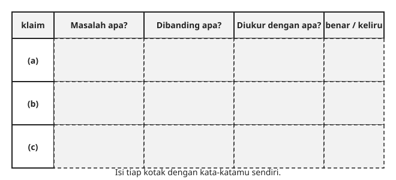

**Ingat dulu:** (1) Bagian mana dari algoritma Shor yang kuantum, dan bagian mana yang klasik? (2) Mengapa keunggulan satu query lawan `2^(n-1) + 1` query tidak berarti komputer kuantum lebih cepat untuk semua masalah?

______



`[Gambar: tabel tiga baris klaim (a), (b), (c) dan kolom Masalah apa?, Dibanding apa?, Diukur dengan apa?, benar / keliru. Semua kotak kosong untuk diisi.]`

**Prediksi:** Keadaan seragam `N = 1024` item (10 qubit) punya satu jawaban. Tebak: (1) dari 1000 shot, jawaban terbaca ____ kali; (2) bila lebih dulu dipasang 25 pengulangan Grover, ____ kali; (3) untuk `N = 2^40` kira-kira ______ pengulangan Grover. Apakah itu berarti "seketika"? ______

**Lengkapi:** (1) Untuk `N = 2^30`, pengulangan Grover kira-kira `(pi/4) x 2^15` = ____ (bulatkan). (2) Isi bagian kosong.

```cpp setengah-jadi
size_t baca(const Vektor& a) {
    double r = acak01(), kumulatif = 0.0;
    for (size_t i = 0; i < a.size(); i++) {
        kumulatif += a[i] * ____;  // peluang = kuadrat amplitudo
        if (r < kumulatif) return i;
    }
    return a.size() - 1;
}
```

**Susun:** Susun baris berikut menjadi isi fungsi `ringkas`. Kurung kurawal penutup sengaja dihilangkan. Urutan: ______

```text
(a) std::set<size_t> beda;
(b)     beda.insert(hasil);
(c) int kena = 0;
(d)     if (hasil == jawaban) kena++;
(e) for (int i = 0; i < shot; i++) {
(f)     size_t hasil = baca(a);
```

**Latihan:**

1. (`AI: tanpa AI`) Peluang satu shot dari keadaan seragam `N = 1024` membaca jawaban adalah `1/1024`. Hitung peluang 1000 shot tidak pernah membacanya, dan jelaskan mengapa "0 kali" bukan kejanggalan. ______
2. (`AI: tanpa AI`) Dengan tiga pertanyaan penguji, nilai klaim karangan berikut dan isi tabel pada gambar. (a) "Chip kuantum baru memecahkan semua enkripsi dalam hitungan detik." (b) "Komputer kuantum menghitung semua kemungkinan sekaligus, sehingga rute terbaik ditemukan seketika." (c) "Dengan algoritma Grover, mencari satu item di antara satu triliun cukup sekitar sejuta langkah."
3. (`AI: boleh`) Ubah jumlah pengulangan menjadi 10 dan 40. Prediksi dulu peluangnya dengan rumus `e-xii1-m5`, lalu jalankan. ______

**Cek diri:**

- [ ] Saya dapat menyebut tiga pertanyaan penguji klaim "lebih cepat".
- [ ] Saya dapat menjelaskan mengapa superposisi bukan "mencoba semua sekaligus".
- [ ] Saya dapat membedakan keunggulan kuadrat dari keunggulan eksponensial.

**Catatan cetak (untuk guru, tidak dicetak):** satu sampai dua halaman A4. Kunci ada di modul `e-xii1-m7` bagian "Kunci dan petunjuk". Lembar tidak memuat kolom identitas.
