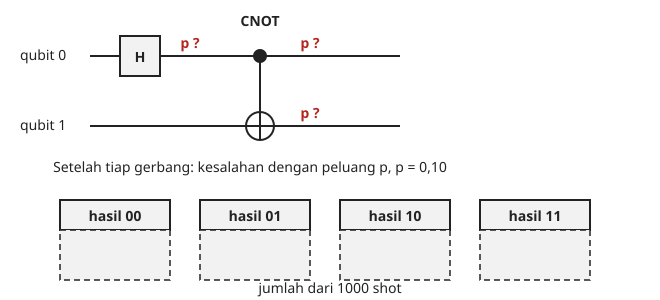

**Ingat dulu:** (1) Apa rumus peluang item bertanda setelah `t` pengulangan Grover, dengan `sin(theta) = 1/akar N`? (2) Bagaimana membandingkan hasil 1000 shot dengan peluang hitungan tangan memakai simpangan wajar?

______



`[Gambar: sirkuit Bell dua qubit: H pada qubit 0, lalu CNOT. Setelah tiap gerbang ada tanda "p ?" untuk kesalahan. Di bawah ada empat kotak hasil 00, 01, 10, 11, masing-masing dengan isian jumlah dari 1000 shot. Isi dengan perkiraanmu.]`

**Prediksi:** Setelah tiap gerbang terjadi kesalahan acak dengan peluang `p` pada salah satu qubit yang disentuh gerbang: separuh membalik bit (X), separuh membalik tanda (Z). (1) Sirkuit pada gambar, 1000 shot, `p = 0,10`: hasil apa yang muncul padahal tidak ada pada keadaan ideal, dan kira-kira berapa kali? ______ (2) Untuk 100 gerbang dengan `p = 0,01`, kira-kira ____ persen shot tidak mengalami satu kesalahan pun.

**Lengkapi:** (1) Untuk `p = 0,01` dan `m = 100`, `0,99^100` kira-kira ____. (2) Isi bagian kosong.

```cpp setengah-jadi
void tunggu(Vektor& v, double q) {
    if (acak01() < ____) balik_tanda(v, 1, 0);
}
```

**Susun:** Susun baris berikut menjadi isi satu putaran `for (int s ...)` pada `peluang_nol_setelah_tunggu`. Urutan: ______

```text
(a)         gerbang_h(v, 1, 0);   // H kedua
(b)         Vektor v = {1.0, 0.0};
(c)         if (baca(v) == 0) nol++;
(d)         for (int i = 0; i < t; i++) tunggu(v, q);
(e)         gerbang_h(v, 1, 0);   // H pertama
```

**Latihan:**

1. (`AI: tanpa AI`) Dengan `p = 0,02` per gerbang, berapa peluang tanpa kesalahan untuk 30 gerbang, dan berapa gerbang paling sedikit agar peluangnya turun di bawah 0,5? ______
2. (`AI: boleh`) Pakai `p = 0,05` pada Bell. Prediksi dulu jumlah hasil terlarang dari 1000 shot dan rentang tiga simpangan, lalu jalankan dan bandingkan. ______
3. (`AI: tanpa AI`) Mengapa kesalahan Z tidak mengubah histogram Bell tetapi mengubah hasil H, tunggu, H? ______

**Cek diri:**

- [ ] Saya dapat menyebut tiga sumber derau dan makna kasar `T1` dan `T2`.
- [ ] Saya dapat menghitung `(1 - p)^m` dan menjelaskan akibatnya bagi sirkuit dalam.
- [ ] Saya dapat menjelaskan mengapa dekoherensi merusak interferensi.

**Catatan cetak (untuk guru, tidak dicetak):** satu sampai dua halaman A4. Kunci ada di modul `e-xii1-m8` bagian "Kunci dan petunjuk". Lembar tidak memuat kolom identitas.
