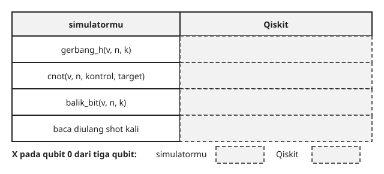

**Ingat dulu:** (1) Sebutkan langkah sirkuit Bernstein-Vazirani berurutan dan apa yang dibaca di akhir. (2) Apa itu orde `r` dari `a` modulo `N`, dan bagaimana `r` memberi faktor `N`?

______



`[Gambar: tabel dua kolom, simulatormu dan Qiskit. Kolom simulatormu berisi gerbang_h, cnot, balik_bit, dan baca diulang shot kali. Kolom Qiskit kosong untuk diisi. Di bawahnya dua isian label hasil X pada qubit 0 dari tiga qubit, di simulatormu dan di Qiskit.]`

**Prediksi:** Guru menjalankan `qc = QuantumCircuit(3)` lalu `qc.x(0)` dan mencetak peluang tiap hasil (kamu tidak menjalankannya). (1) Hasil yang berpeluang 1 ditulis `100` atau `001`? ______ (2) Untuk Bell, histogram 1000 shot dari Qiskit persis 500 dan 500 atau tidak? ______ Berapa selisih yang wajar? ______

**Lengkapi:** (1) Simulatormu menulis `gerbang_h(v, 2, 1); cnot(v, 2, 1, 0);`. Di Qiskit: `qc.h(____)` lalu `qc.cx(____, ____)`. (2) Isi penerjemah label.

```cpp setengah-jadi
std::string label_qiskit(const std::string& s) {
    return std::string(s.____(), s.____());
}
```

**Susun:** Susun baris Python berikut menjadi program yang membuat sirkuit Bell, mengukurnya, menjalankan 1000 shot, dan mencetak histogram. Baris `sampler = ...` boleh di mana saja sebelum `hasil = ...`. Urutan: ______

```text
(a) hasil = sampler.run([qc], shots=1000).result()[0]
(b) qc.measure_all()
(c) qc.cx(0, 1)
(d) print(hasil.data.meas.get_counts())
(e) qc = QuantumCircuit(2)
(f) qc.h(0)
(g) sampler = StatevectorSampler(seed=2026)
```

**Latihan:**

1. (`AI: tanpa AI`) Simulatormu menjalankan, dari `|000>`: H pada qubit 0, X pada qubit 2, CNOT 0 ke 1. Tulis kode Qiskit-nya, lalu hasil yang mungkin dengan label simulatormu dan label Qiskit beserta peluangnya. ______
2. (`AI: boleh`) Sirkuit Qiskit: `qc.h(0)`, `qc.cx(0, 1)`, `qc.cx(1, 2)`, lalu `measure_all()`. Prediksi histogram 1000 shot dan gambarkan sirkuitnya. ______
3. (`AI: tanpa AI`) Mengapa `StatevectorSampler` tidak pernah memberi `01` atau `10` untuk Bell, padahal perangkat nyata bisa? ______

**Cek diri:**

- [ ] Saya dapat menerjemahkan sirkuit kecil antara simulatorku dan Qiskit.
- [ ] Saya dapat menukar label hasil antara urutan simulatorku dan Qiskit.
- [ ] Saya tahu bahwa blok Python modul ini demonstrasi guru dan saya tidak menjalankannya.

**Catatan cetak (untuk guru, tidak dicetak):** satu sampai dua halaman A4. Kunci ada di modul `e-xii1-m9` bagian "Kunci dan petunjuk". Lembar tidak memuat kolom identitas.
