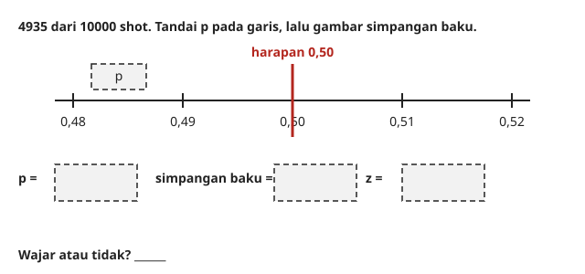

**Ingat dulu:** (1) Mengapa histogram 1000 shot dari peluang 0,5 tidak persis 500, dan berapa simpangan wajarnya? (2) Bagaimana membandingkan hasil 1000 shot dengan peluang hitungan tangan memakai simpangan wajar?

______



`[Gambar: garis bilangan 0,48 sampai 0,52 dengan tanda merah pada 0,50 berlabel harapan. Di atasnya kotak kosong p untuk menaruh proporsi. Di bawahnya isian p, simpangan baku, z, dan "Wajar atau tidak?", untuk 4935 dari 10000 shot.]`

**Prediksi:** Sirkuit Bell ideal dijalankan 1000 shot di simulator tanpa derau. (1) Kira-kira `00` muncul ______ kali (beri rentang). (2) Bila percobaan diulang, apakah angkanya sama? ______ (3) Agar lebar selang menyempit menjadi setengahnya, diperlukan kira-kira ______ shot.

**Lengkapi:** (1) Simpangan baku untuk 300 dari 1000 shot: `akar(0,3 x 0,7 / 1000)` = ____. (2) Lengkapi bagian selang Wilson.

```cpp setengah-jadi
double tengah = p + z2 / (2.0 * ____);
double akar = Z95 * std::sqrt(p * (1.0 - p) / ____ + z2 / (4.0 * n * n));
```

**Susun:** Susun baris berikut menjadi fungsi `normal`. Urutan: ______

```text
(a)     double e = Z95 * std::sqrt(p * (1.0 - p) / n);
(b) Selang normal(int k, int n) {
(c)     double p = k / double(n);
(d)     return {p - e, p + e};
(e) }
```

**Latihan:**

1. (`AI: tanpa AI`) Untuk 4935 dari 10000 shot: hitung `p`, simpangan baku, dan `z` terhadap 0,5 dengan tangan, dan isi gambar. Apakah selisihnya wajar? ______
2. (`AI: boleh`) Pada program, ganti ke 4935 dari 10000. Prediksi dulu apakah selang Wilson memuat 0,5, lalu jalankan. ______
3. (`AI: tanpa AI`) Mengapa 0 hasil terlarang dari 1000 shot belum membuktikan bahwa peluangnya nol? ______

**Cek diri:**

- [ ] Saya dapat menghitung proporsi dan simpangan baku dari sebuah histogram.
- [ ] Saya dapat menghitung selang Wilson dan menafsirkannya dengan benar.
- [ ] Saya tahu empat kali shot menyempitkan selang setengahnya.

**Catatan cetak (untuk guru, tidak dicetak):** satu sampai dua halaman A4. Kunci ada di modul `e-xii2-m1` bagian "Kunci dan petunjuk". Blok Python demonstrasi guru tidak disalin ke lembar. Lembar tidak memuat kolom identitas.
