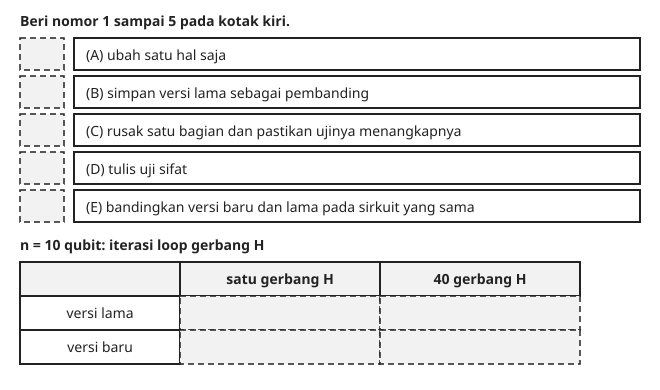

**Ingat dulu:** (1) Mengapa menguji satu model derau saja tidak cukup untuk menyatakan hasil mitigasi benar? (2) Bila uji GHZ gagal karena peluang `000` bukan 0,5, tiga hal apa yang diperiksa lebih dulu?

______

`[Gambar: bagian atas memuat lima langkah sprint berhuruf A sampai E dalam urutan acak, masing-masing dengan kotak nomor kosong. Bagian bawah: tabel iterasi loop untuk n = 10 qubit dengan baris versi lama dan versi baru, kolom satu gerbang H dan 40 gerbang H, semua sel kosong.]`

**Susun:** Beri nomor 1 sampai 5 pada langkah sprint di gambar sehingga urutannya benar. Tujuan sprint: "satu perbaikan atau optimasi masuk, dan tiga uji (sifat, regresi, mutasi) tetap hijau". Urutan: ______

**Latihan:**

1. Pada `n = 10` qubit, berapa iterasi loop satu gerbang `H` pada versi lama dan baru, dan berapa total untuk 40 gerbang `H`? Isi tabel pada gambar.
2. Tulis uji kecil yang menunjukkan bahwa `X` adalah kebalikan dirinya sendiri pada satu qubit. ______
3. Mengapa mengoptimalkan sebelum ada uji hijau berbahaya, dan apa yang menjaga agar optimasi tidak mengubah hasil? ______
4. Sebutkan dua sifat yang dapat diuji tanpa jawaban hitung tangan per kasus. ______

**Cek diri:**

- [ ] Saya dapat menulis uji norma dan uji pembalikan.
- [ ] Saya dapat membuktikan optimasi tidak mengubah hasil.
- [ ] Saya dapat menjelaskan batas uji mutasi.

**Catatan cetak (untuk guru, tidak dicetak):** satu halaman A4. Kunci ada di modul `e-xii2-m10` bagian "Kunci dan petunjuk". Bagian Prediksi dan Lengkapi dilewati karena modul sprint ini tidak memuatnya. Lembar tidak memuat kolom identitas.
