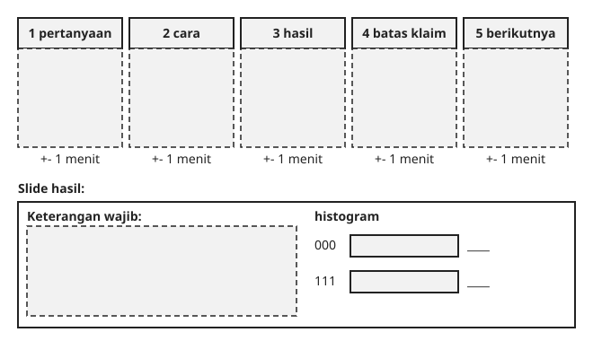

**Ingat dulu:** (1) Mengapa energi estimasi bisa berbeda dari energi eksak walau parameter sudah hampir optimum? (2) Pada Grover `N = 8`, mengapa peluang `t = 3` lebih kecil daripada `t = 2`?

______

`[Gambar: bagian atas lima kotak bagian presentasi (pertanyaan, cara, hasil, batas klaim, langkah berikutnya), kira-kira satu menit masing-masing, dengan ruang isian kosong. Bagian bawah: bingkai slide hasil dengan kotak keterangan wajib kosong dan dua batang histogram 000 dan 111 tanpa angka.]`

**Susun:** Tujuan sprint: "lima menit yang dapat diikuti orang yang belum pernah melihat proyekku, dengan satu klaim yang kubuktikan dan satu batas yang kusebut". Pada gambar, tulis satu kalimat untuk tiap bagian presentasi proyekmu. Slide hasil memerlukan keterangan wajib di sampingnya: tulis apa saja isinya di kotak keterangan.

**Latihan:**

1. Dari 1000 shot, hasil `000` muncul 530 kali pada GHZ ideal. Hitung `z` dan putuskan apakah kamu menampilkannya sebagai "sesuai" atau menyelidikinya. ______
2. Tulis satu kalimat batas klaim untuk presentasi tentang simulator Grover `N = 8`. ______
3. Apa yang boleh dan tidak boleh ditampilkan pada slide demo? ______
4. Mengapa kalimat "sudah terbukti" perlu diganti pada slide hasil simulasi, dan dengan apa? ______

**Cek diri:**

- [ ] Saya dapat menyebut lima bagian presentasiku.
- [ ] Saya dapat menyebut keterangan wajib di samping hasil.
- [ ] Saya punya rencana cadangan bila demo gagal.

**Catatan cetak (untuk guru, tidak dicetak):** satu halaman A4. Kunci ada di modul `e-xii2-m11` bagian "Kunci dan petunjuk". Bagian Prediksi dan Lengkapi dilewati karena modul sprint ini tidak memuatnya. Lembar tidak memuat kolom identitas.
