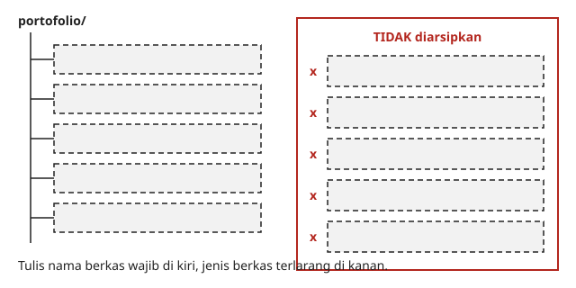

**Ingat dulu:** (1) Apa beda dampak komputer kuantum pada kunci publik (Shor) dan kunci simetris (Grover) menurut sumbermu? (2) Mengapa lolos dari pemeriksa pola belum berarti dokumentasi bebas data pribadi?

______

`[Gambar: di kiri pohon folder portofolio dengan lima baris isian kosong untuk berkas dan folder wajib. Di kanan kotak "TIDAK diarsipkan" dengan lima baris isian kosong untuk jenis berkas atau data yang terlarang.]`

**Susun:** Tujuan sprint: "portofolio yang dapat dibuka orang lain tanpa penjelasanku dan tanpa data pribadi apa pun". Isi gambar: tulis berkas wajib portofolio di kiri dan jenis berkas yang tidak diarsipkan di kanan. Lalu beri nomor 1 sampai 5 pada langkah berikut agar urutannya benar. Urutan: ______

- (A) Baca semua berkas dengan mata, termasuk gambar dan nama berkas.
- (B) Salin hanya yang akan diarsipkan ke folder baru.
- (C) Minta satu teman membuka folder dan menyebut apa yang tidak ia pahami.
- (D) Jalankan pemeriksa.
- (E) Tulis README dan manifes berkas.

**Latihan:**

1. Sebuah proyek ditutup dengan hasil negatif (tabel uji gagal pada `t = 3`). Haruskah masuk portofolio, dan apa yang ditulis di batas klaim? ______
2. Sebuah histogram di slide tanpa tanggal dan model derau. Apa yang ditambahkan sebelum diarsipkan? ______
3. Mengapa nama pekerjaan cloud asli dan tangkapan layar akun tidak boleh diarsipkan? ______
4. Apa yang boleh dan tidak boleh ditampilkan pada slide demo? ______

**Cek diri:**

- [ ] Saya dapat menyebut berkas wajib portofolio.
- [ ] Saya dapat menyebut apa yang tidak boleh diarsipkan.
- [ ] Saya menulis batas klaim dan status proyek dengan jujur.

**Catatan cetak (untuk guru, tidak dicetak):** satu halaman A4. Kunci ada di modul `e-xii2-m12` bagian "Kunci dan petunjuk". Bagian Prediksi dan Lengkapi dilewati karena modul sprint ini tidak memuatnya. Lembar tidak memuat kolom identitas.
