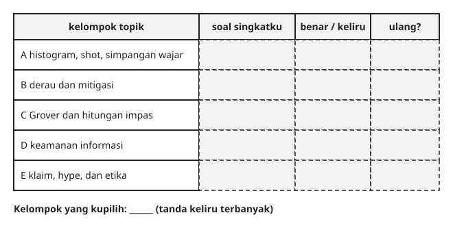

**Ingat dulu:** (1) Beri dua contoh tanda hype dalam artikel populer tentang komputasi kuantum. (2) Berkas apa saja yang wajib ada di portofolio, dan jenis berkas apa yang tidak boleh?

______



`[Gambar: tabel lima baris kelompok topik A sampai E (histogram, shot, simpangan wajar; derau dan mitigasi; Grover dan hitungan impas; keamanan informasi; klaim, hype, dan etika). Kolom soal singkatku, benar / keliru, dan ulang? kosong. Di bawahnya isian kelompok yang dipilih.]`

**Prediksi:** Sirkuit Bell (`H`, lalu `CNOT`) dibaca 1000 shot, tetapi tiap qubit salah terbaca dengan peluang `r = 0,03` secara bebas. Tebak: (1) kira-kira ____ dari 1000 shot memberi hasil `01` atau `10`; (2) kira-kira ____ memberi `00`.

**Lengkapi:** Sebuah simulator memberi hasil benar pada 95 dari 400 shot; peluang yang dihitung tangan 0,2.

1. Harapan: `400 x 0,2` = ____.
2. Simpangan wajar: `akar(400 x 0,2 x 0,8)` = ____.
3. Rentang tiga simpangan: ____ sampai ____; `z = (95 - 80) / ____` = ____. Wajar atau diselidiki? ______

**Susun:** Susun langkah berikut menjadi urutan menutup satu celah belajar. Urutan: ______

```text
(a) Tukar ringkasan dengan kelompok lain dan minta mereka menjawab dari ingatan.
(b) Pilih kelompok topik dengan tanda keliru terbanyak.
(c) Jawab satu soal per kelompok dari ingatan, tanpa catatan.
(d) Jadwalkan ulang soal yang masih keliru beberapa hari kemudian.
(e) Tulis ringkasan satu halaman dengan satu soal dan kunci hitung tangan.
(f) Cek jawaban dengan kunci dan tandai yang keliru.
```

**Latihan:**

1. (`AI: tanpa AI`) Tulis satu soal untuk tiap kelompok A sampai E pada gambar, jawab dari ingatan, cek kunci, dan tandai. Tulis kelompok yang kamu pilih.
2. (`AI: tanpa AI`) Ulangi hitungan contoh Bell dengan `r = 0,05`: peluang `01`, hasil terlarang per 1000 shot, dan simpangan wajarnya. ______
3. (`AI: tanpa AI`) Pilih satu soal yang keliru dan jawab lagi tiga hari kemudian; catat hasilnya sebagai satu kalimat. ______

**Cek diri:**

- [ ] Saya sudah menandai celahku pada lima kelompok topik.
- [ ] Saya sudah menjadwalkan ulang soal yang keliru.
- [ ] Saya dapat menjelaskan mengapa uji diri lebih baik daripada membaca ulang.

**Catatan cetak (untuk guru, tidak dicetak):** satu sampai dua halaman A4. Kunci ada di modul `e-xii2-m13` bagian "Kunci dan petunjuk". Lembar tidak memuat kolom identitas.
