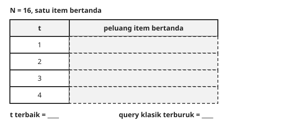

**Ingat dulu:** (1) Tulis uji kecil yang menunjukkan bahwa gerbang `H` adalah kebalikan dirinya sendiri. (2) Bila tabel uji tetap lulus setelah kode dirusak sengaja, apa artinya bagi tabel itu? (3) Mengapa batas klaim harus tertulis pada proyek yang hanya simulasi?

______

`[Gambar: tabel dengan baris t = 1, 2, 3, 4 dan kolom peluang item bertanda yang kosong, untuk N = 16 dengan satu item bertanda. Di bawahnya isian t terbaik dan query klasik terburuk.]`

**Latihan:** Kerjakan tanpa AI dan tulis langkahmu.

1. **Histogram.** Simulator ideal memberi `000` sebanyak 540 dari 1000 shot pada GHZ. Hitung `z` terhadap 500 dan tulis tiga hal yang kamu periksa sebelum menyimpulkan. ______
2. **Grover.** Untuk `N = 16` dengan satu item bertanda, isi tabel pada gambar untuk `t = 1`, `2`, `3`, `4`, tentukan `t` terbaik, dan tulis query klasik terburuk.
3. **Derau dan mitigasi.** Sirkuit 30 gerbang dengan peluang bersih 0,99 per gerbang: berapa peluang tanpa kesalahan? Apa yang dilakukan mitigasi derau dan apa yang tidak dilakukannya? ______
4. **Hibrida.** Satu algoritma hibrida memakai 25 iterasi, 4 pengaturan per iterasi, 500 shot. Berapa pembacaan sirkuit, dan mengapa angka itu belum menyatakan keunggulan kuantum? ______
5. **Portofolio.** Sebutkan tiga jenis berkas yang tidak boleh diarsipkan dan satu hal yang tidak dapat ditangkap pemeriksa pola. ______

**Cek diri:**

- [ ] Saya dapat menilai histogram dengan `z` dan memeriksa penyebab bila tidak wajar.
- [ ] Saya dapat menghitung peluang Grover dan menyebut batas klaimnya.
- [ ] Saya dapat menguji proyek dengan hitung tangan, uji sifat, dan uji mutasi.

**Catatan cetak (untuk guru, tidak dicetak):** satu halaman A4. Asesmen ini tanpa AI. Kunci ada di modul `e-xii2-m14` bagian "Kunci dan petunjuk". Bagian Prediksi, Lengkapi, dan Susun dilewati karena modul asesmen ini tidak memuatnya; Refleksi bersifat pribadi sehingga tidak dicetak. Lembar tidak memuat kolom identitas.
