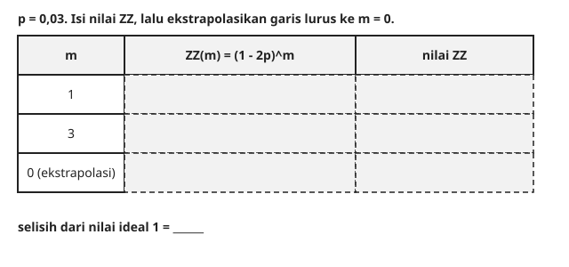

**Ingat dulu:** (1) Bila hasil terlarang tidak pernah muncul pada 1000 shot, mengapa itu belum berarti peluangnya nol? (2) Sebutkan tiga sumber derau pada perangkat kuantum nyata.

______



`[Gambar: tabel dengan baris m = 1, m = 3, dan m = 0 (ekstrapolasi), kolom rumus ZZ(m) = (1 - 2p)^m dan nilai ZZ yang kosong, untuk p = 0,03. Di bawahnya isian selisih dari nilai ideal 1.]`

**Prediksi:** Sirkuit Bell (H lalu CNOT) mengukur `ZZ` (+1 bila dua bit sama, -1 bila beda; ideal 1). CNOT diulang 1, 3, atau 5 kali; efek idealnya tidak berubah, hanya derau yang bertambah. Kesalahan gerbang `p = 0,03` dan kesalahan baca `r = 0,02`. (1) `ZZ` mentah turun atau naik bila CNOT diulang? ______ Kira-kira berapa untuk satu CNOT? ______ (2) Apakah koreksi baca saja membuat hasilnya tepat 1? ______ (3) Apakah ekstrapolasi ke nol derau pasti memberi tepat 1? ______

**Lengkapi:** (1) `ZZ` mentah 0,8650 dengan `r = 0,02`: setelah koreksi baca menjadi `0,8650 / (0,96 x 0,96)` = ____. (2) Lengkapi bagian koreksi baca.

```cpp setengah-jadi
double skala = (1.0 - 2.0 * rh) * (1.0 - 2.0 * ____);
y[i] = zz(M[i], p, r, shot) / ____;  // koreksi baca
```

**Susun:** Susun baris berikut menjadi fungsi `kalibrasi_baca`. Urutan: ______

```text
(a)         if (acak01() < r) terbalik++;  // bit kedua
(b) double kalibrasi_baca(double r, int shot) {
(c)     return terbalik / (2.0 * shot);
(d)     for (int s = 0; s < shot; s++) {
(e)         if (acak01() < r) terbalik++;  // bit pertama
(f)     }
(g)     int terbalik = 0;
(h) }
```

**Latihan:**

1. (`AI: tanpa AI`) Bila `ZZ(m) = (1 - 2p)^m` dengan `p = 0,03`, hitung `ZZ(1)` dan `ZZ(3)`, isi tabel pada gambar, lalu ekstrapolasi garis lurus dua titik itu ke faktor 0. Berapa selisihnya dari nilai ideal 1? ______
2. (`AI: tanpa AI`) Mengapa simpangan baku antar putaran lebih besar setelah ekstrapolasi, dan apa artinya bagi jumlah shot? ______
3. (`AI: boleh`) Ubah `JENIS_X` menjadi `false`. Prediksi dulu nilai `ZZ` pada `m = 1, 3, 5`, lalu jalankan dan jelaskan mengapa ekstrapolasi tidak lagi berarti. ______

**Cek diri:**

- [ ] Saya dapat membedakan penekanan derau, mitigasi, dan koreksi kesalahan.
- [ ] Saya dapat menjelaskan koreksi baca dan gate folding.
- [ ] Saya dapat menyebut tiga biaya atau batas mitigasi.

**Catatan cetak (untuk guru, tidak dicetak):** satu sampai dua halaman A4. Kunci ada di modul `e-xii2-m2` bagian "Kunci dan petunjuk". Lembar tidak memuat kolom identitas.
