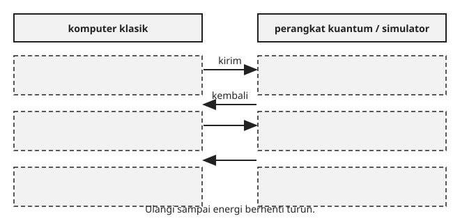

**Ingat dulu:** (1) Mengapa ekstrapolasi nol-derau memerlukan lebih banyak shot dan tetap belum tentu tak bias? (2) Mengapa satu selang 95 persen yang tidak memuat nilai ideal belum membuktikan ada sebab selain acak shot?

______



`[Gambar: dua lajur: komputer klasik di kiri dan perangkat kuantum atau simulator di kanan, masing-masing dengan tiga kotak isian kosong. Panah kirim dan kembali menghubungkan kedua lajur. Di bawahnya tertulis: ulangi sampai energi berhenti turun.]`

**Prediksi:** Keadaan `Ry(theta)|0>` punya amplitudo `(cos(theta/2), sin(theta/2))`. Energinya terhadap `H = 0,6 Z + 0,8 X` adalah `E(theta) = 0,6 cos(theta) + 0,8 sin(theta)`. (1) Energi terendah yang mungkin ______. (2) Pada `theta = 0,5`, menaikkan atau menurunkan `theta` yang menurunkan energi? ______ (3) Bila energi dihitung dari hanya 10 shot per pengukuran, bolehkah estimasi energi lebih rendah dari energi terendah sebenarnya? ______

**Lengkapi:** (1) Gradien eksak pada `theta = 0,5` adalah ____ (empat desimal). (2) Lengkapi bagian klasik.

```ts setengah-jadi
const g = (energiEstimasi(theta + Math.PI / 2, shot) - energiEstimasi(theta - ____, shot)) / 2;
return theta - ____ * g;
```

**Susun:** Susun baris berikut menjadi bagian awal fungsi `rata2` yang menyiapkan keadaan dan memutar basis. Urutan: ______

```text
(a)   if (basis === "X") {
(b)     [a, b] = [(a + b) / Math.SQRT2, (a - b) / Math.SQRT2]; // gerbang H sebelum baca
(c)   }
(d)   let [a, b] = [Math.cos(theta / 2), Math.sin(theta / 2)];
(e)   const peluang0 = a * a;
```

**Latihan:**

1. (`AI: tanpa AI`) Hitung dengan tangan `E(1,0)` dan gradien `dE/dtheta` pada `theta = 1,0`; arah mana yang menurunkan energi? ______
2. (`AI: tanpa AI`) Mengapa estimasi energi di bawah energi dasar tidak berarti alamnya dilanggar? ______
3. (`AI: boleh`) Isi diagram pada gambar untuk QAOA dengan `p = 1`: apa yang ada di sisi kuantum dan apa di sisi klasik.

**Cek diri:**

- [ ] Saya dapat menggambar pola hibrida dan menandai sisi kuantum dan klasiknya.
- [ ] Saya dapat menelusuri satu iterasi pergeseran parameter.
- [ ] Saya dapat menjelaskan mengapa estimasi energi bisa di bawah energi dasar.

**Catatan cetak (untuk guru, tidak dicetak):** satu sampai dua halaman A4. Kunci ada di modul `e-xii2-m3` bagian "Kunci dan petunjuk". Lembar tidak memuat kolom identitas.
