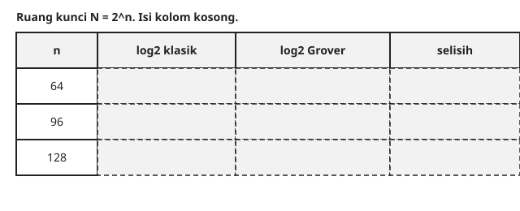

**Ingat dulu:** (1) Pada algoritma hibrida, bagian mana dijalankan di perangkat kuantum dan bagian mana di komputer klasik? (2) Mengapa hitungan query Grover belum berarti komputer kuantum lebih cepat dalam waktu nyata?

______



`[Gambar: tabel dengan baris n = 64, 96, 128 dan kolom log2 klasik, log2 Grover, dan selisih. Semua sel kecuali n kosong, untuk ruang kunci N = 2^n.]`

**Prediksi:** Sebuah kunci simetris 128 bit dicari dengan mencoba kunci satu per satu. (1) Rata-rata secara klasik kira-kira 2 pangkat ____ percobaan. (2) Iterasi Grover yang diperlukan kira-kira 2 pangkat ____. (3) Apakah pengurangan itu otomatis berarti kunci 128 bit tidak aman terhadap komputer kuantum nyata? ______

**Lengkapi:** (1) Untuk `n = 64`, `log2` iterasi Grover satu perangkat adalah `log2(pi/4) + 64/2` = ____ (satu desimal). (2) Lengkapi.

```cpp setengah-jadi
double klasik = n - ____;
double grover = std::log2(PI / 4.0) + n / ____;
```

**Susun:** Susun baris berikut menjadi bagian dalam program yang menghitung klasik per mesin. Urutan: ______

```text
(a)     for (int n : {64, 80, 128, 192, 256}) {
(b)         double klasik_p = klasik - log2_S;
(c)     }
(d)         double klasik = n - 1.0;
```

**Latihan:**

1. (`AI: tanpa AI`) Untuk `n = 96`, hitung `log2` langkah klasik rata-rata, `log2` iterasi Grover satu perangkat, dan selisihnya. Isi juga baris lain pada gambar.
2. (`AI: tanpa AI`) Tulis dua kalimat tentang dampak komputasi kuantum pada kriptografi, masing-masing dengan sumber dari daftar rujukan modul (judul, alamat, bagian). Tandai kalimat yang tidak dapat kamu sumberkan. ______
3. (`AI: boleh`) Nilai tiap klaim: bersumber, terlalu luas, atau tidak bersumber (dan sumber apa yang dibutuhkan). (a) "Komputer kuantum akan memecahkan semua enkripsi." (b) "NIST merilis tiga standar utama kriptografi pasca-kuantum pada Agustus 2024." (c) "AES-128 sudah tidak aman terhadap komputer kuantum." ______

**Cek diri:**

- [ ] Saya dapat menjelaskan dampak Shor pada kunci publik dengan sumber.
- [ ] Saya dapat menjelaskan mengapa dampak Grover pada kunci simetris lebih kecil.
- [ ] Saya dapat menandai klaim yang terlalu luas atau tidak bersumber.

**Catatan cetak (untuk guru, tidak dicetak):** satu sampai dua halaman A4. Kunci ada di modul `e-xii2-m4` bagian "Kunci dan petunjuk". Lembar tidak memuat kolom identitas.
