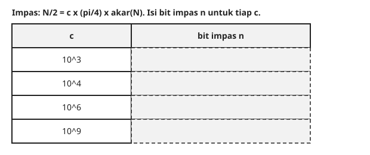

**Ingat dulu:** (1) Apa yang dikatakan NIST tentang Grover dan AES-128, dan apa dua alasan yang disebut? (2) Apa yang dilakukan mitigasi derau, dan apa yang tidak dilakukannya?

______



`[Gambar: tabel dengan baris c = 10^3, 10^4, 10^6, 10^9 dan kolom bit impas n yang kosong. Di atasnya tertulis syarat impas N/2 = c x (pi/4) x akar(N).]`

**Prediksi:** Anggap satu langkah kuantum `c = 10^6` kali lebih mahal daripada satu langkah klasik (pengandaian, bukan data perangkat). Klasik memakai kira-kira `N/2` langkah; Grover kira-kira `(pi/4) x akar(N)` langkah, masing-masing `c` kali lebih mahal. (1) Pada 40 bit, apakah Grover lebih murah? ______ (2) Pada 100 bit, apakah Grover lebih murah, dan kira-kira berapa kali? ______

**Lengkapi:** (1) Untuk `c = 10^6`: `2 x log2(10^6 x pi / 2)` = ____ bit (satu desimal). (2) Lengkapi.

```cpp setengah-jadi
double bit_impas = 2.0 * std::log2(c * PI / ____);
```

**Susun:** Susun baris berikut menjadi versi pendek dari bagian dalam program. Urutan: ______

```text
(a)     for (double c : {1.0, 1e3, 1e6, 1e9}) {
(b)         double bit_impas = 2.0 * std::log2(c * PI / 2.0);
(c)         std::printf("%-35.0e %8.1f\n", c, bit_impas);
(d)     }
```

**Latihan:**

1. (`AI: tanpa AI`) Hitung dengan tangan bit impas untuk `c = 10^3`. ______
2. (`AI: boleh`) Tambahkan `c = 10^4`. Prediksi dulu bit impas, lalu jalankan dan isi gambar. ______
3. (`AI: boleh`) Tulis satu paragraf: bagaimana kamu melaporkan hasil demonstrasi (simulator atau perangkat) kepada teman yang bukan murid jalur E tanpa melebih-lebihkan? ______

**Cek diri:**

- [ ] Saya dapat menyebut tiga pertanyaan untuk menguji klaim populer.
- [ ] Saya dapat menjelaskan mengapa percepatan kuadrat belum tentu lebih murah.
- [ ] Saya dapat menulis refleksi tentang kejujuran pelaporan.

**Catatan cetak (untuk guru, tidak dicetak):** satu sampai dua halaman A4. Kunci ada di modul `e-xii2-m5` bagian "Kunci dan petunjuk". Soal analisis artikel karangan tidak disalin ke lembar. Lembar tidak memuat kolom identitas.
